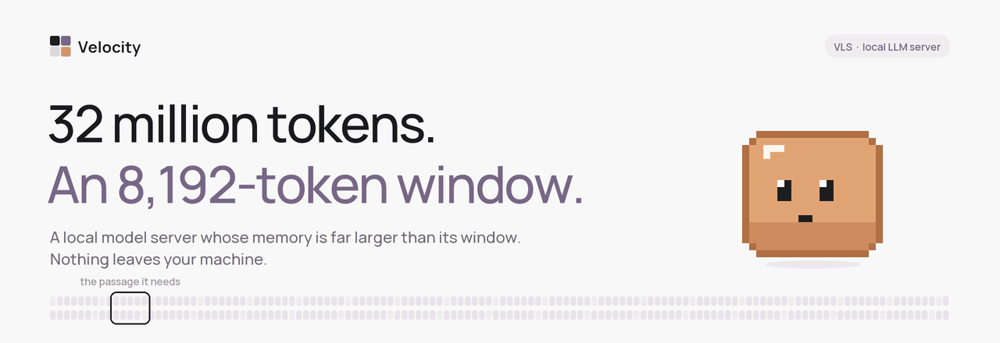

<div align="center">



<br><br>

[](https://github.com/Veloresearch/VLS-32M-Context-Local-LLM/releases/latest)
[](https://github.com/Veloresearch/VLS-32M-Context-Local-LLM/releases)
[](https://github.com/Veloresearch/VLS-32M-Context-Local-LLM)

[](#install)
[](#install)
[](https://veloresearch.com/reports/velocity-context-evaluation.pdf)

**[Install](#install)** &nbsp;·&nbsp; **[Use it from your agent](#use-it-from-the-agent-you-already-have)** &nbsp;·&nbsp; **[Velocity Context](#velocity-context)** &nbsp;·&nbsp; **[Measured](#measured-not-claimed)** &nbsp;·&nbsp; **[API](#one-address-for-everything)** &nbsp;·&nbsp; **[FAQ](#questions-people-actually-ask)**

</div>

<br>

<div align="center">

### A local model server whose memory is far larger than its window.

A 4B model with an 8,192-token window answered across **32,000,000 tokens** in **653 ms** -
on a 6 GB laptop card. Nothing left the machine.

**Start VLS. Start your agent. It works.**

<br>

<table>
<tr>
<td align="center" width="150"><br><b>opencode</b><br><sub>one-press connect</sub></td>
<td align="center" width="150"><br><b>Hermes Agent</b><br><sub>one-press connect</sub></td>
<td align="center" width="150"><br><b>Any OpenAI app</b><br><sub>Continue, Cline, LangChain, your code</sub></td>
</tr>
</table>

</div>

<br>

## Preview 50

The fiftieth build, and the one we would show anyone.

| | |
|---|---|
| **Agents, connected in one press** | opencode and Hermes Agent are wired in from the new **Apps** page. Any other OpenAI app needs an address and nothing else - no key from this computer, any model name. |
| **Memory per project** | A coding agent working in three repositories keeps three memories. A new chat in the same project shares that project's memory. |
| **Speech, listening and pictures on the same address** | `/v1/audio/speech`, `/v1/audio/transcriptions` and `/v1/images/generations` answer beside chat. Over a hundred voices, any image model in your library. |
| **Faster on hybrid models** | Qwen3.5 and Qwen3-Next now run every layer on the card; their cache was being counted four times over. |
| **A calmer panel** | A new sidebar, Settings, Hardware and context pages, a command palette that does things, and a living orb in fourteen styles. |

<br>

<a name="install"></a>
## Install

One command. No account, no sign-in, no telemetry, no Docker.

**Windows**

```powershell
irm https://github.com/Veloresearch/VLS-32M-Context-Local-LLM/releases/latest/download/install.ps1 | iex
```

**Linux**

```bash
curl -fsSL https://github.com/Veloresearch/VLS-32M-Context-Local-LLM/releases/latest/download/install.sh | sh
```

The installer looks at the machine before it downloads anything and takes the build that suits it -
**CUDA** where there is an NVIDIA card, **Vulkan** on Linux where there is any card at all, the
**processor** otherwise - and opens the panel when it is done. Updates install themselves from
Settings. Removing it is deleting one folder; your models and memories live somewhere else.

<div align="center"><br><br><br></div>

<a name="use-it-from-the-agent-you-already-have"></a>
## Use it from the agent you already have

<div align="center"></div>

<br>

Open **Apps** in the panel and press **Connect** beside the agent you use:

| | | what Connect does |
|---|---|---|
|  | **opencode** | adds VLS as a normal provider in `~/.config/opencode/opencode.json` and makes it the model opencode starts with |
|  | **Hermes Agent** | points `~/.hermes/config.yaml` at VLS as its custom endpoint, keeping your previous model to put back |

Not an MCP plug-in and not a bridge: VLS is the model provider itself, the same way a cloud API would be.

The next time the agent starts, it is talking to the model on your machine. **Disconnect** removes
exactly what Connect added; nothing else in those files is touched, and a backup is kept the first time.

For anything else that speaks the OpenAI API - Continue, Cline, LangChain, your own script:

```
Base URL   http://127.0.0.1:11500/v1
API key    anything (none is needed from this computer)
Model      velocity  (or any name - it reaches the loaded model)
```

### What the agent remembers

Every application gets its own memory without anyone setting it up, and a coding agent gets **one
per project** - it says which folder it is working in, and VLS keeps that project's memory apart from
the others. A new chat in the same project picks up where the last one left off; a different repository
starts clean. Each app can be switched to one shared memory, or to remembering nothing, on its card.

<br>

<a name="velocity-context"></a>
## Velocity Context

<div align="center"></div>

<br>

A model's window is a hard limit paid for in memory. Velocity Context gives the model something to
reach into instead of a bigger window: you add material once - a folder, a repository, your notes, or
simply the conversation as it happens - and every question after that can reach all of it. VLS hands
the model the few passages the answer needs and shows you exactly what it handed over.

- **Not RAG.** No embedding model, no vector database, no chunk size, no second service to run.
- **On your disk.** A context is a `.mfyc` file you own, built in seconds, outliving any model you load.
- **Explainable.** Every answer carries a receipt with the exact text the model was given.
- **Flat cost.** Thirty-two times the material, the same half second.

| context | one-time build | answer, median | answer, p90 |
|---|---:|---:|---:|
| 1M tokens | 0.5 s | 703 ms | 890 ms |
| 10M tokens | 5.3 s | 570 ms | 1 081 ms |
| 20M tokens | 10.6 s | 708 ms | 1 117 ms |
| **32M tokens** | **17.2 s** | **653 ms** | **1 111 ms** |

How it was measured, what the controls were and where the results stop are in the
**[technical report](https://veloresearch.com/research/velocity-context)**
([PDF, 14 pages](https://veloresearch.com/reports/velocity-context-evaluation.pdf)).
The method itself we keep to ourselves.

<br>

## Everything in it

<div align="center"></div>

<br>

| | |
|---|---|
| **Chat** | Text, photos and files, voice conversation with live transcription, web search, thinking you can see and time. |
| **Studio** | Images and video from local diffusion models, speech in over a hundred Piper voices, all on this machine. |
| **Models** | Search Hugging Face from the panel; each build is checked against your card *before* it downloads. |
| **Apps** | One-press connection for opencode and Hermes Agent; the address for everything else. |
| **Contexts** | Memories you can read, search, share between apps, or keep per project. |
| **Hardware** | What the machine has, what is using it, and whether anything is wrong. |
| **Mesh** | Every machine in your house as one - a model too big for one card is split across them. |

<div align="center"><br><br><br></div>

<a name="one-address-for-everything"></a>
## One address for everything

```bash
# chat
curl http://127.0.0.1:11500/v1/chat/completions -H "content-type: application/json" \
  -d '{"model":"velocity","messages":[{"role":"user","content":"hello"}]}'

# speech - any installed voice, or the default for OpenAI voice names
curl http://127.0.0.1:11500/v1/audio/speech -H "content-type: application/json" \
  -d '{"input":"Hello from this computer.","voice":"en_US-ryan-high"}' -o hello.wav

# listening
curl http://127.0.0.1:11500/v1/audio/transcriptions -F file=@hello.wav

# pictures
curl http://127.0.0.1:11500/v1/images/generations -H "content-type: application/json" \
  -d '{"prompt":"a small orange cube with a face, pixel art","size":"512x512"}'
```

```python
from openai import OpenAI
client = OpenAI(base_url="http://127.0.0.1:11500/v1", api_key="local")
print(client.chat.completions.create(model="velocity",
      messages=[{"role": "user", "content": "hello"}]).choices[0].message.content)
```

From another machine on your network the same address works with the key from the panel's **API** page.

<br>

<a name="measured-not-claimed"></a>
## Measured, not claimed

One laptop: **RTX 3060 Laptop, 6 GB**, **Qwen3.5-4B-Q4_K_M**, an **8 192-token window**.

**NVIDIA's RULER**, on their harness, nothing underneath it modified:

| | 4k | 16k | 32k | 64k | 128k |
|---|---:|---:|---:|---:|---:|
| **13-task average** | **100.0** | **74.8** | **85.5** | **89.1** | **86.9** |

**Beyond 128k**, on our own ladder with the same task definitions - reported separately, never averaged in:

| | 1M | 5M | 10M | 15M | 20M | 25M | 32M |
|---|---:|---:|---:|---:|---:|---:|---:|
| **nine-task average** | **97.8** | **95.6** | **100** | **97.8** | **97.8** | **100** | **100** |

The per-task tables, the samples per cell and the parts that do not flatter us are in the
[technical report](https://veloresearch.com/research/velocity-context). Every benchmark can be run on
your own machine from the panel.

<br>

## Built on

VLS is a router with Velocity Context behind it. The memory, the routing, the hardware fit, the mesh and
the panel are ours. **[llama.cpp](https://github.com/ggml-org/llama.cpp)** (MIT) runs the GGUF models,
**[stable-diffusion.cpp](https://github.com/leejet/stable-diffusion.cpp)** the pictures, **[Piper](https://github.com/rhasspy/piper)**
and **[faster-whisper](https://github.com/SYSTRAN/faster-whisper)** the voice - their licences travel inside every package.

<br>

<a name="questions-people-actually-ask"></a>
## Questions people actually ask

**Does anything leave my machine?** No. The only outbound requests are the ones you ask for: searching
Hugging Face, downloading what you chose, and checking for a newer release. No telemetry, no account.

**Do I need a GPU?** No. A card makes it faster; the processor build works everywhere.

**Which models work?** Any GGUF that llama.cpp runs, Piper voices, and diffusion models for Studio.

**Is it open source?** No. VLS is free for personal use; companies need a licence - write to
**contact@veloresearch.com**. See [LICENSE](LICENSE).

**Is it finished?** It is a preview. When you find a rough edge,
**[open an issue](https://github.com/Veloresearch/VLS-32M-Context-Local-LLM/issues)** - it is the fastest
way to get it fixed.

<br>

<div align="center">


### If VLS is useful to you, a star is the whole ask

[](https://github.com/Veloresearch/VLS-32M-Context-Local-LLM)

<br>


**Velocity** · local runtimes and long-context execution

[veloresearch.com](https://veloresearch.com) &nbsp;·&nbsp; [@velo_research](https://x.com/velo_research) &nbsp;·&nbsp; [contact@veloresearch.com](mailto:contact@veloresearch.com)

</div>
