<a name="top"></a>

<div align="center">

<br>

<picture>
  <source media="(prefers-color-scheme: dark)" srcset="assets/brand/impulse-lockup-on-dark.svg">
  <source media="(prefers-color-scheme: light)" srcset="assets/brand/impulse-lockup-on-light.svg">
  
</picture>

### Intelligence with longer memory.

**Impulse** runs AI models on your own computer. Load any GGUF model and work with it:
chat with web search and tools, voice, pictures, computer use, and an OpenAI-compatible API and MCP
for every other app you use. With **Momentum**, a model can reach far past its own window: up to
**32M tokens** of your material. Nothing leaves the machine.

<br>

<a href="https://github.com/Veloresearch/impulse/releases/latest/download/VLSSetup.exe"></a>
&nbsp;
<a href="https://github.com/Veloresearch/impulse/releases/latest/download/VLS-linux-x64.tar.gz"></a>

<br>

[](https://github.com/Veloresearch/impulse/releases/latest)
[](https://github.com/Veloresearch/impulse/releases)
[](https://github.com/Veloresearch/impulse/stargazers)
[](#install)
[](#momentum)
[](#one-address-for-everything)
[](LICENSE)

<br>


<sub>A real recording on a 6 GB laptop card: the question is looked up, the pages are read, and the answer cites them. Nothing runs in the cloud.</sub>

<br><br>

**[Install](#install)** &nbsp;·&nbsp; **[Momentum](#momentum)** &nbsp;·&nbsp; **[Benchmarks](#measured-not-claimed)** &nbsp;·&nbsp; **[Evaluation report](https://veloresearch.com/research/momentum)** &nbsp;·&nbsp; **[Release notes](https://github.com/Veloresearch/impulse/releases/latest)** &nbsp;·&nbsp; **[veloresearch.com](https://veloresearch.com/impulse)**

</div>

<br>


## Contents

| | |
|---|---|
| **See it** | [Why Impulse](#why-impulse) · [What it does](#what-it-does) · [The details](#the-details) |
| **Memory** | [Momentum](#momentum) · [Measured, not claimed](#measured-not-claimed) |
| **Use it** | [Chat](#chat) · [Computer use](#computer-use) · [Look inside the model](#look-inside-the-model) · [Studio, Plugins and Apps](#studio-plugins-and-apps) |
| **Set up** | [Make it yours](#make-it-yours) · [Install](#install) · [FAQ](#faq) |
| **Connect** | [Use it from the agent you already have](#use-it-from-the-agent-you-already-have) · [One address for everything](#one-address-for-everything) |

<br>

## Why Impulse

- **One app for running models locally.** Download or add a GGUF model, and Impulse chooses how it runs on your graphics card. Chat, voice, pictures and an OpenAI-compatible API on one address, in one install, with a panel that explains itself.
- **More than the model's window.** With Momentum a model works across far more material than its window holds: add a folder, a repository or a year of notes once, and every question can reach all of it, up to 32M tokens.
- **Private by construction.** No account, no telemetry, no Docker. The only outbound requests are the ones you ask for.

Most local runners load a model and give you its window. Impulse does that too, and adds what sits around the model: a memory far larger than the window, tools the model can use, a computer it can operate with your permission, and a way to see how it wrote each answer.

<picture>
  <source media="(prefers-color-scheme: light)" srcset="assets/screens/home-light.png">
  
</picture>

<p align="right"><sub><a href="#top">Back to top</a></sub></p>

<a name="what-it-does"></a>
## What it does

Real recordings of the app with a 9B model on a 6 GB laptop card. Nothing is staged or edited; long waits are sped up and marked.

<table>
<tr>
<td width="50%" valign="top"><br><sub><b>Personalities</b>: spin the wheel and the face in the middle answers you, from Sarcastic to Professional</sub></td>
<td width="50%" valign="top"><br><sub><b>Momentum in every chat</b>: pick a context from the deck and the chat can reach all of it, here 1.4M tokens of source code</sub></td>
</tr>
<tr>
<td width="50%" valign="top">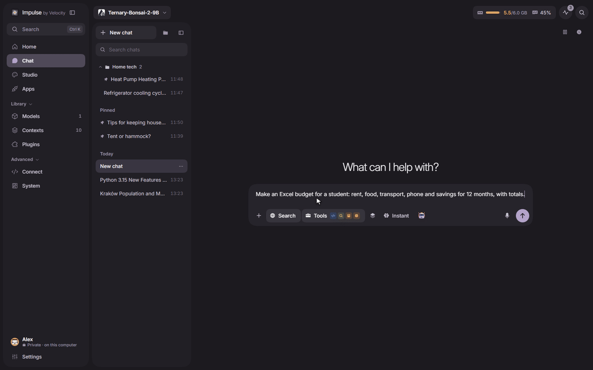<br><sub><b>Files, made for you</b>: ask for a spreadsheet and get a real .xlsx you can open beside the chat</sub></td>
<td width="50%" valign="top">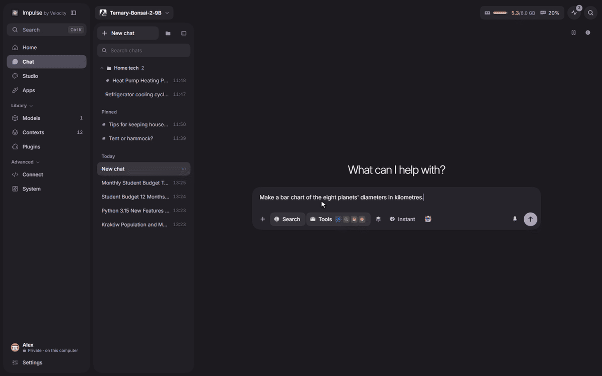<br><sub><b>Charts from the answer</b>: numbers become a chart you can open beside the conversation</sub></td>
</tr>
<tr>
<td width="50%" valign="top">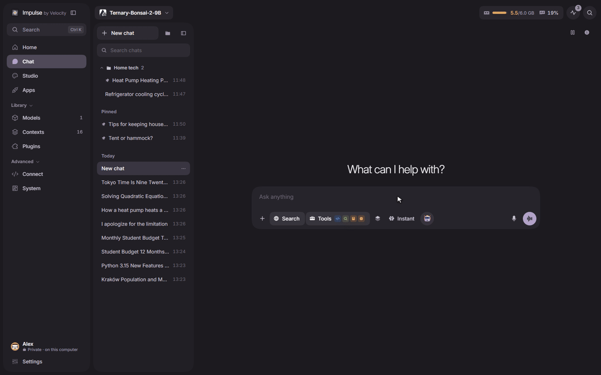<br><sub><b>Your own data</b>: drop a CSV and ask about it</sub></td>
<td width="50%" valign="top">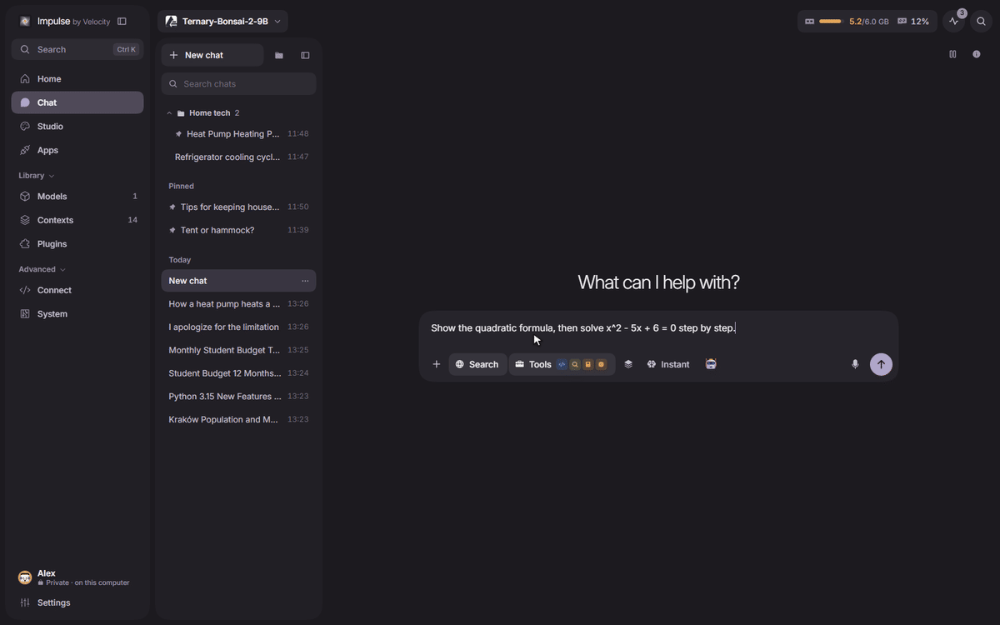<br><sub><b>Maths, typeset</b>: formulas render properly, step by step</sub></td>
</tr>
</table>

<p align="right"><sub><a href="#top">Back to top</a></sub></p>

<a name="momentum"></a>
## Momentum

<picture>
  <source media="(prefers-color-scheme: dark)" srcset="assets/brand/momentum-lockup-on-dark.svg">
  <source media="(prefers-color-scheme: light)" srcset="assets/brand/momentum-lockup-on-light.svg">
  
</picture>

### Your knowledge. *Within reach.*

**Momentum** gives your AI relevant evidence from millions of tokens.
Momentum selects the passages your model needs, within the window it already has.

Use it in place of a large native context window: the model keeps a small, fast window, and Momentum
supplies what each question needs. You add material once (a folder, a repository, your notes, or
simply the conversation as it happens) and every question after that can reach all of it.

Benchmarked across **32M tokens**, configurable up to **1B**, and shown working on the full Linux kernel source.

<p align="center">
<picture>
  <source media="(prefers-reduced-motion: reduce) and (prefers-color-scheme: dark)" srcset="assets/brand-art/momentum-how-dark.svg">
  <source media="(prefers-reduced-motion: reduce)" srcset="assets/brand-art/momentum-how-light.svg">
  <source media="(prefers-color-scheme: dark)" srcset="assets/brand-art/momentum-how-animated-dark.svg">
  <source media="(prefers-color-scheme: light)" srcset="assets/brand-art/momentum-how-animated-light.svg">
  
</picture>
</p>

| | |
|---|---|
| **Local processing** | Material is processed on the machine where Momentum is installed. |
| **Works with the model's own tokenizer** | Sizes are counted in the loaded model's tokens, so what you see is what the model sees. |
| **No embedding model or vector database** | Not RAG: no chunk size and no second service to run. |
| **Portable .mfyc files** | A context is a file you own, built in seconds and independent of the model you load. |
| **Inspectable source passages** | Every answer shows the exact passages the model was given. |

If you point Impulse at a cloud model, the passages Momentum selects for a question are sent to that provider.

**Answer time stays under 0.8 s**, from 1M to 32M tokens (median; the build is a one-time text pass):

| context | one-time build | answer, median | answer, p90 |
|---|---:|---:|---:|
| 1M tokens | 0.5 s | 703 ms | 890 ms |
| 5M tokens | 2.6 s | 488 ms | 982 ms |
| 10M tokens | 5.3 s | 570 ms | 1 081 ms |
| 15M tokens | 8.0 s | 643 ms | 1 132 ms |
| 20M tokens | 10.6 s | 708 ms | 1 117 ms |
| 25M tokens | 13.4 s | 752 ms | 1 128 ms |
| **32M tokens** | **17.2 s** | **653 ms** | **1 111 ms** |

<p align="center">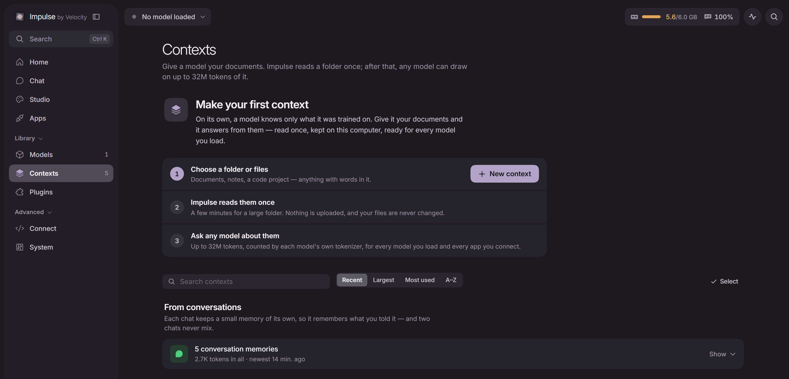</p>

<a name="measured-not-claimed"></a>
### Measured, not claimed

One laptop: **RTX 3060 Laptop, 6 GB**, **Qwen3.5-4B-Q4_K_M**, an **8,192-token window** throughout.
The full method, the per-task tables and the limits are in the
**[evaluation report](https://veloresearch.com/research/momentum)**
([PDF](https://veloresearch.com/reports/velocity-context-evaluation.pdf)).

| benchmark | result |
|---|---|
| **NVIDIA RULER at 128K**, 13 tasks, 20 samples each, NVIDIA's harness unmodified | **90.0** average |
| **BABILong QA1**, 100 published samples per length | **92.0%** at 128K, **86.0%** at 1M; **0.0%** with the text removed |
| **Answer time at 32M tokens** | **653 ms** median |

**Beyond 128K**, on the app's built-in ladder with nine of RULER's tasks and five samples per cell. This is a
separate benchmark lane, reported on its own and never averaged with the result above:

| | 1M | 5M | 10M | 15M | 20M | 25M | 32M |
|---|---:|---:|---:|---:|---:|---:|---:|
| **nine-task average** | **97.8** | **95.6** | **100** | **97.8** | **97.8** | **100** | **100** |

<div align="center">
<picture>
  <source media="(prefers-color-scheme: dark)" srcset="assets/brand-art/momentum-ladder-dark.svg">
  <source media="(prefers-color-scheme: light)" srcset="assets/brand-art/momentum-ladder-light.svg">
  
</picture><br><br>
<picture>
  <source media="(prefers-color-scheme: dark)" srcset="assets/brand-art/momentum-latency-dark.svg">
  <source media="(prefers-color-scheme: light)" srcset="assets/brand-art/momentum-latency-light.svg">
  
</picture>
</div>

<br>

Every benchmark can be run on your own machine from the panel.

<p align="right"><sub><a href="#top">Back to top</a></sub></p>

## Chat

Text, photos and files, voice with live transcription, and a model that looks things up before it answers.

**Search first, with sources.** A question about a part number, a price, a datasheet or anything recent is searched before the model writes a word. You watch the pages being read, and every claim in the answer points back to its source.

**Exact maths.** A built-in calculator works with units, constants and radio and circuit formulas, and shows every step. The model does not do arithmetic in its head.

<table>
<tr>
<td width="50%"><br><sub><b>Diagrams</b>: flowcharts drawn inside the answer</sub></td>
<td width="50%"><br><sub><b>Instant facts</b>: the time anywhere, answered at once</sub></td>
</tr>
</table>

**Drawings for electronics.** Schematics are checked before you see them: every pin connected, every value in range. Pin-outs, wiring diagrams and antenna aiming are drawn the same way, and a schematic exports to KiCad.

**A Python sandbox.** The model writes and runs Python in the page, with numpy, pandas and matplotlib and no internet needed, and the files it makes appear as cards you can open or save.

<p align="center">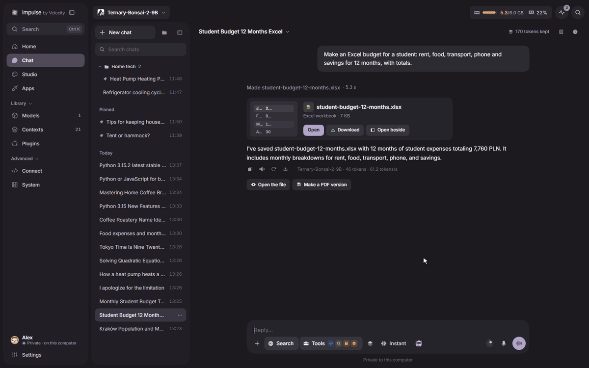<br><sub><b>Open beside</b>: the file it made, previewed next to the chat</sub></p>

**Everything an answer needs around it.** Save any answer as PDF, Markdown or an image. See what it cost: time to first words, writing speed, tokens read and written, and how much of the window it used. Find anything in a long conversation with Ctrl+F.

<table>
<tr>
<td width="50%"><br><sub><b>Save as</b>: PDF, Markdown or an image</sub></td>
<td width="50%"><br><sub><b>Answer details</b>: what one answer took</sub></td>
</tr>
<tr>
<td width="50%">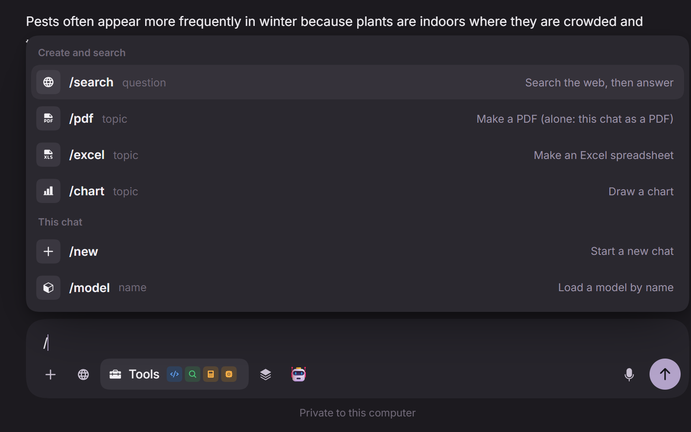<br><sub><b>/ commands</b>: search, a PDF, a spreadsheet, a chart, a model</sub></td>
<td width="50%"><br><sub><b>@ mentions</b>: attach a file or answer from a memory</sub></td>
</tr>
</table>

Enter sends, Shift+Enter starts a new line, Esc stops, ↑ edits your last message. Long pasted text becomes a chip with its size in tokens.

<p align="right"><sub><a href="#top">Back to top</a></sub></p>

## Computer use

Your local model can open apps, click, type and fill in forms. It reads each window's buttons and fields directly instead of guessing from pixels, and falls back to a screenshot for apps that do not describe themselves.

**Its own cursor.** A second pointer shows where it is going and what it is doing. Your mouse stays yours.

**You decide how much it may do.** Watch only, Ask every time, Ask before risky actions (the default), or Act without asking. It is off until you turn it on.

**You can always stop it.** Esc, Stop, or moving the mouse into the top-left corner halts it at once. Pause, Take over and Continue hand control back and forth.

- It never types into password fields, always asks before closing unsaved work, and never acts on a window you did not name.
- Choose which screen it works on. Every action is recorded in an activity log.
- It works with the sandbox: take something from the screen, process it in Python, put the result back.

**Measured.** Tested with Qwen3.5-4B on Notepad and Calculator tasks: 4 of 4 passed. Reading a window takes 40-120 ms, and an action takes about half a second.

<p align="center"><br><sub><b>Computer use</b>: one switch, four permission levels, and the screen it works on</sub></p>

Computer use is new and Windows only. Start with *Ask before risky actions*, and check what matters.

<p align="right"><sub><a href="#top">Back to top</a></sub></p>

## Look inside the model

How the last answer was written, one token at a time: what the model chose, how sure it was, and what it nearly said. Then the model itself: every layer, read straight from its file.

<p align="center"></p>

<table>
<tr>
<td width="50%"><br><sub><b>Weights</b>: every layer, brighter where the weights are larger</sub></td>
<td width="50%"><br><sub><b>Shape</b>: how the model is built, as its file describes it</sub></td>
</tr>
</table>

<p align="right"><sub><a href="#top">Back to top</a></sub></p>

<a name="studio-plugins-and-apps"></a>
## Studio, Plugins and Apps

| | |
|---|---|
| **Studio** | Images and video from local diffusion models, speech in over a hundred Piper voices, all on this machine. |
| **Models** | Search Hugging Face from the panel; each build is checked against your card *before* it downloads. |
| **Plugins** | Any MCP server (a folder, GitHub, a database) with one-click presets. Enabled plugins offer their tools in Chat. |
| **Apps** | One-click connection for opencode and Hermes Agent; one address for everything else. |
| **Mesh** | Every machine in your home as one: a model too big for one card is split across them. |

<table>
<tr>
<td width="50%"><picture><source media="(prefers-color-scheme: light)" srcset="assets/screens/studio-light.png">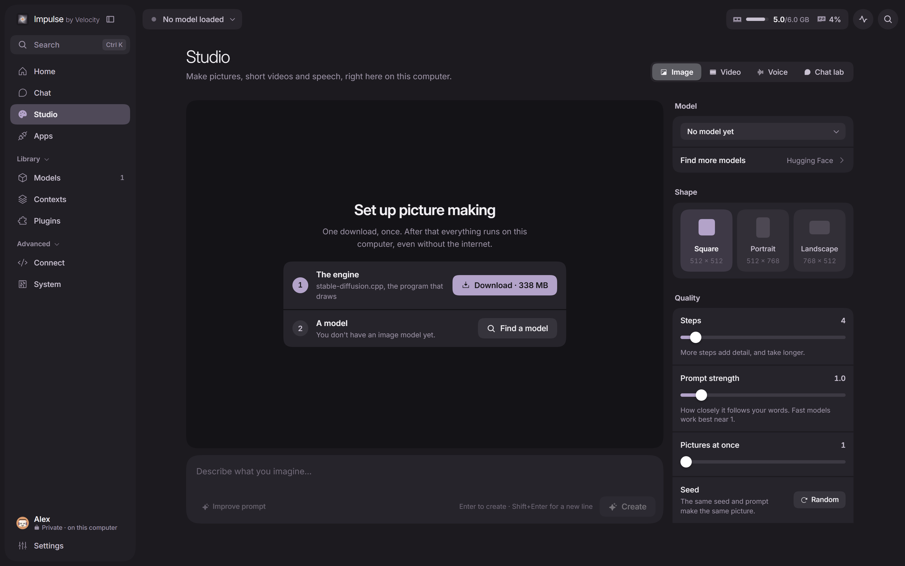</picture><br><sub><b>Studio</b>: pictures, video and speech</sub></td>
<td width="50%"><picture><source media="(prefers-color-scheme: light)" srcset="assets/screens/models-hugging-face-light.png">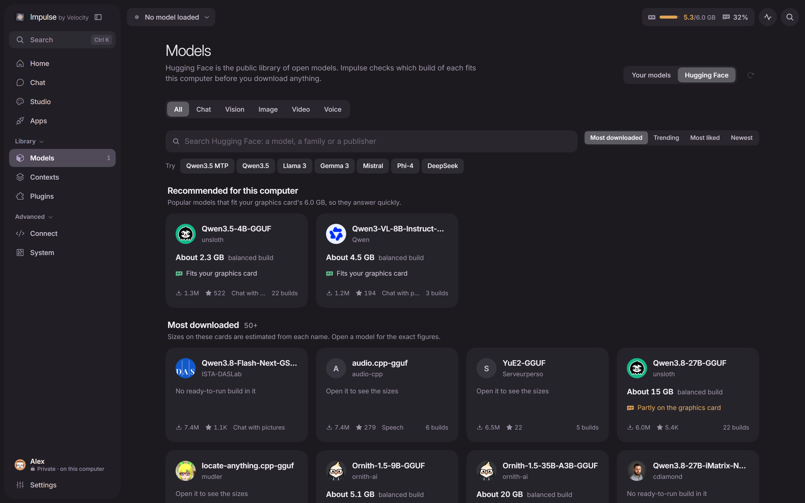</picture><br><sub><b>Models</b>: Hugging Face search, checked against your card before it downloads</sub></td>
</tr>
<tr>
<td width="50%">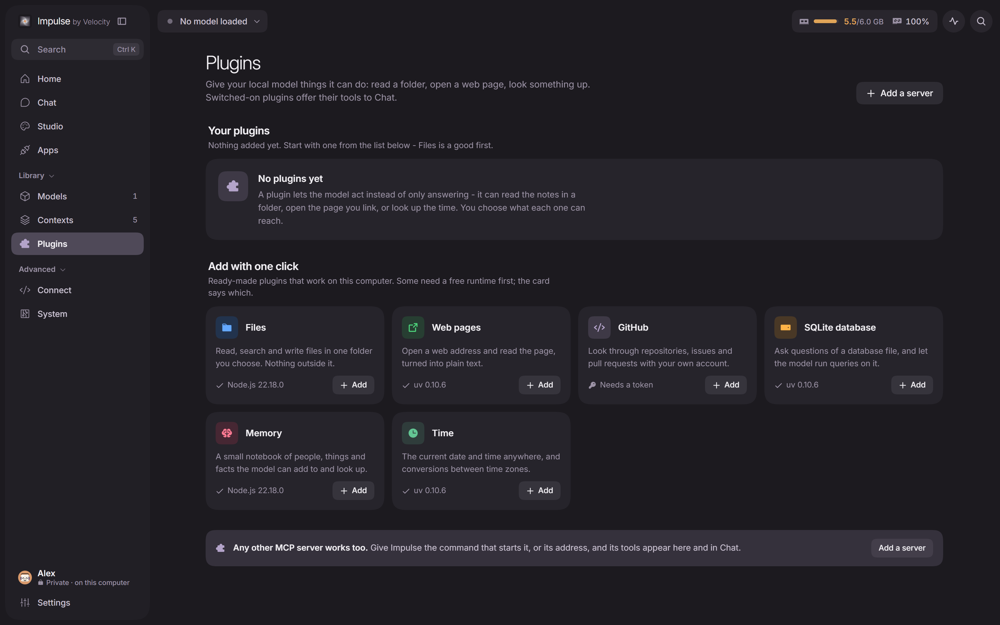<br><sub><b>Plugins</b>: MCP servers, started and monitored by Impulse</sub></td>
<td width="50%">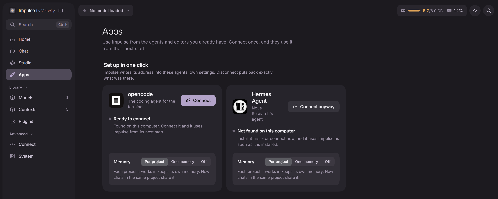<br><sub><b>Apps</b>: connect an agent in one click</sub></td>
</tr>
</table>

<p align="center"><br>
<picture>
  <source media="(prefers-color-scheme: dark)" srcset="assets/brand-art/impulse-how-dark.svg">
  <source media="(prefers-color-scheme: light)" srcset="assets/brand-art/impulse-how-light.svg">
  
</picture>
<br><br></p>

<p align="right"><sub><a href="#top">Back to top</a></sub></p>

<!-- details:start -->
<a name="the-details"></a>
## The details

The small things, recorded in the real app.

**In a chat**

<table>
<tr>
<td width="50%" valign="top"><br><sub><b>Thinking level</b>: Instant to Max on one slider, with a rolling label</sub></td>
<td width="50%" valign="top">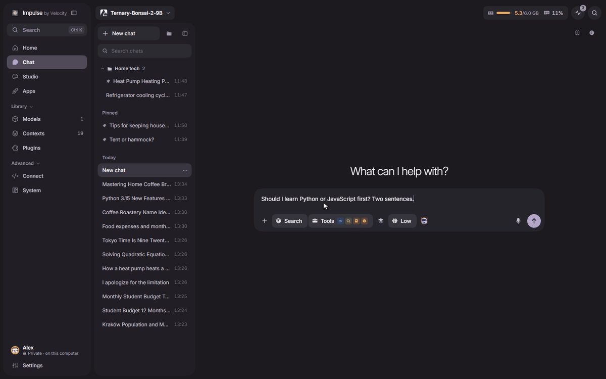<br><sub><b>Thought for</b>: how long it thought, folded into one line</sub></td>
</tr>
<tr>
<td width="50%" valign="top"><br><sub><b>Tools</b>: switch tools on and off; the pill shrinks and grows to match</sub></td>
<td width="50%" valign="top"><br><sub><b>Web search</b>: one tap turns searching the web on or off</sub></td>
</tr>
<tr>
<td width="50%" valign="top"><br><sub><b>Sources</b>: every claim points to its page; all sources one tap away</sub></td>
<td width="50%" valign="top">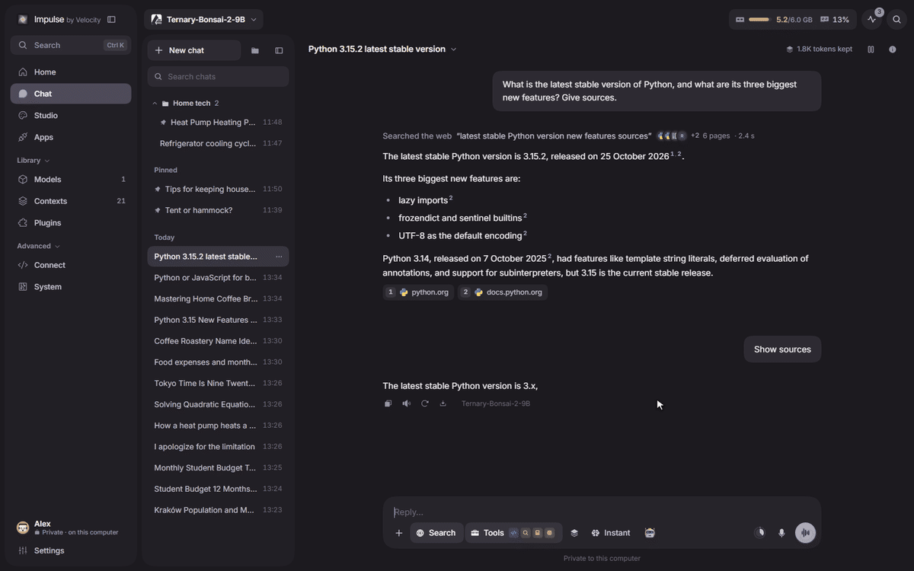<br><sub><b>Tool steps</b>: what it searched, folded to one line and open on a click</sub></td>
</tr>
<tr>
<td width="50%" valign="top">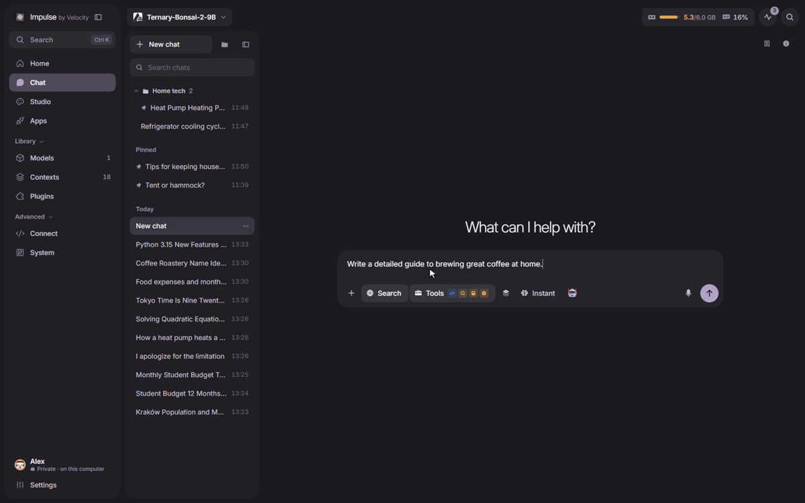<br><sub><b>Writing speed</b>: tokens per second, live while it writes</sub></td>
<td width="50%" valign="top">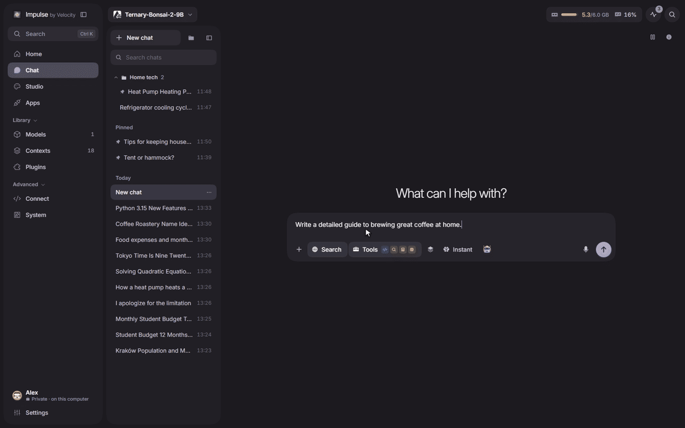<br><sub><b>Stop and regenerate</b>: stop an answer mid-way, ask again</sub></td>
</tr>
<tr>
<td width="50%" valign="top"><br><sub><b>Answer versions</b>: page between answers with ‹ 1/2 ›</sub></td>
<td width="50%" valign="top">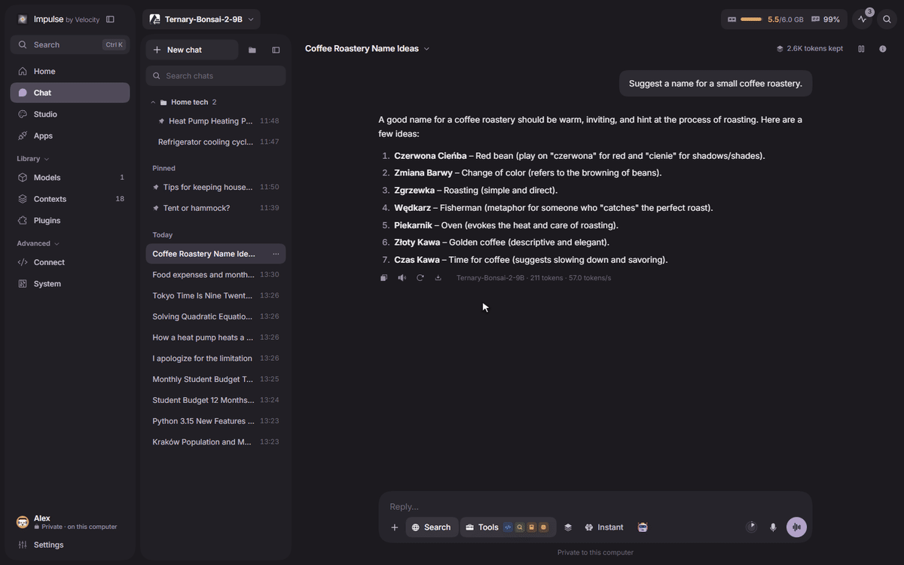<br><sub><b>Edit with ↑</b>: press ↑ to change your last message and send it again</sub></td>
</tr>
<tr>
<td width="50%" valign="top">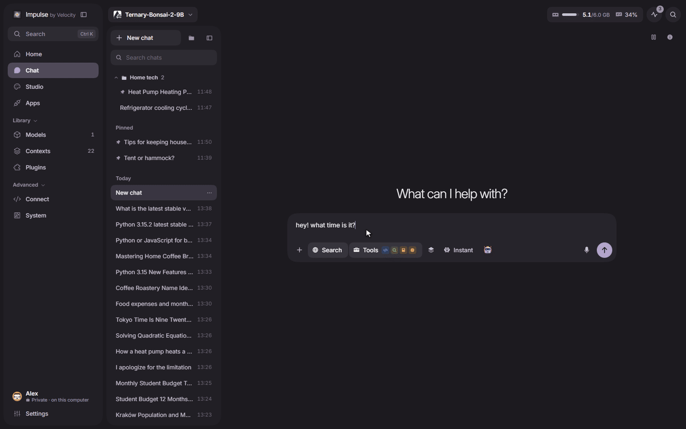<br><sub><b>The time</b>: answered at once, from the clock</sub></td>
<td width="50%" valign="top">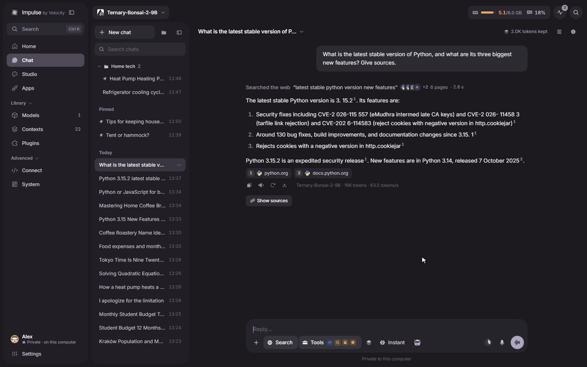<br><sub><b>Copy</b>: one click, with a confirmation</sub></td>
</tr>
<tr>
<td width="50%" valign="top"><br><sub><b>/ commands</b>: type / for every command, a letter narrows it</sub></td>
<td width="50%" valign="top"><br><sub><b>Drop a file</b>: drag it onto the window and it joins the chat</sub></td>
</tr>
<tr>
<td width="50%" valign="top"><br><sub><b>Folders</b>: group chats in folders</sub></td>
<td width="50%" valign="top">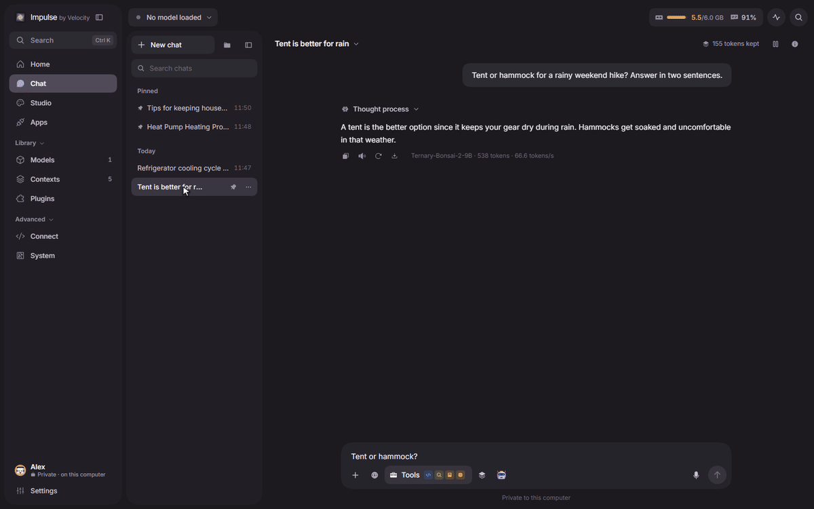<br><sub><b>Rename and pin</b>: double-click a chat to rename it, pin it to the top</sub></td>
</tr>
<tr>
<td width="50%" valign="top"><br><sub><b>Find a chat</b>: search every chat, with the matching words marked</sub></td>
</tr>
</table>

**Around the app**

<table>
<tr>
<td width="50%" valign="top"><br><sub><b>Load a model</b>: the sheet says what fits your card before it starts</sub></td>
<td width="50%" valign="top">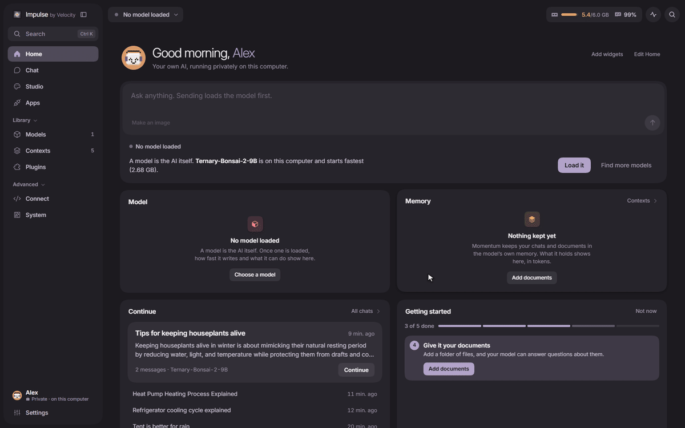<br><sub><b>Ctrl+K</b>: every page, setting and action in one search</sub></td>
</tr>
<tr>
<td width="50%" valign="top">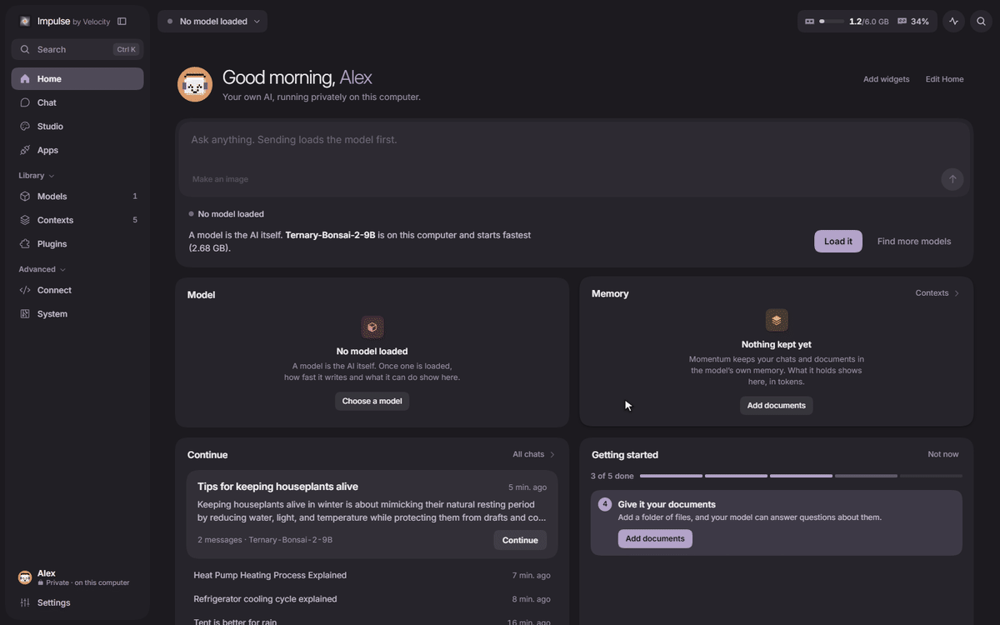<br><sub><b>Ctrl+/</b>: every keyboard shortcut on one sheet</sub></td>
<td width="50%" valign="top"><br><sub><b>Themes</b>: Dark, Light, Cream and Matrix, applied at once</sub></td>
</tr>
<tr>
<td width="50%" valign="top">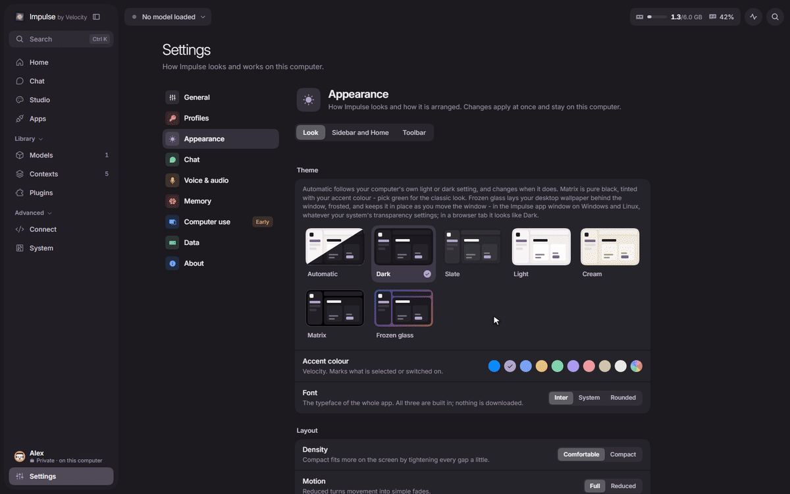<br><sub><b>Accent colour</b>: ten accents, carried across the whole app</sub></td>
<td width="50%" valign="top">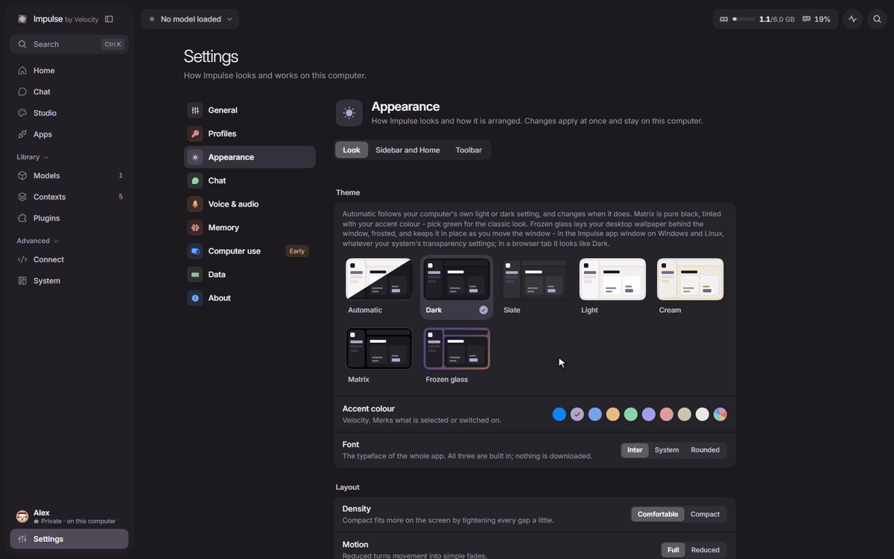<br><sub><b>Fonts</b>: Inter, the system font or a rounded one</sub></td>
</tr>
<tr>
<td width="50%" valign="top"><br><sub><b>Find a model</b>: from an empty Studio to the image models that run here</sub></td>
<td width="50%" valign="top"><br><sub><b>Guided tour</b>: a short tour points at each place the first time</sub></td>
</tr>
</table>

<p align="right"><sub><a href="#top">Back to top</a></sub></p>
<!-- details:end -->

## Make it yours

**Home and the sidebar, arranged your way.** Drag widgets by their handles, resize them, add or remove what you do not use. The sidebar shows what you choose, in your order, under your headings.

<table>
<tr>
<td width="50%"><br><sub><b>Arranging Home</b></sub></td>
<td width="50%"><br><sub><b>Sidebar</b></sub></td>
</tr>
</table>

**Themes.** Dark, Slate, Light and Cream, or follow the system, with nine accents.

<table>
<tr>
<td width="50%">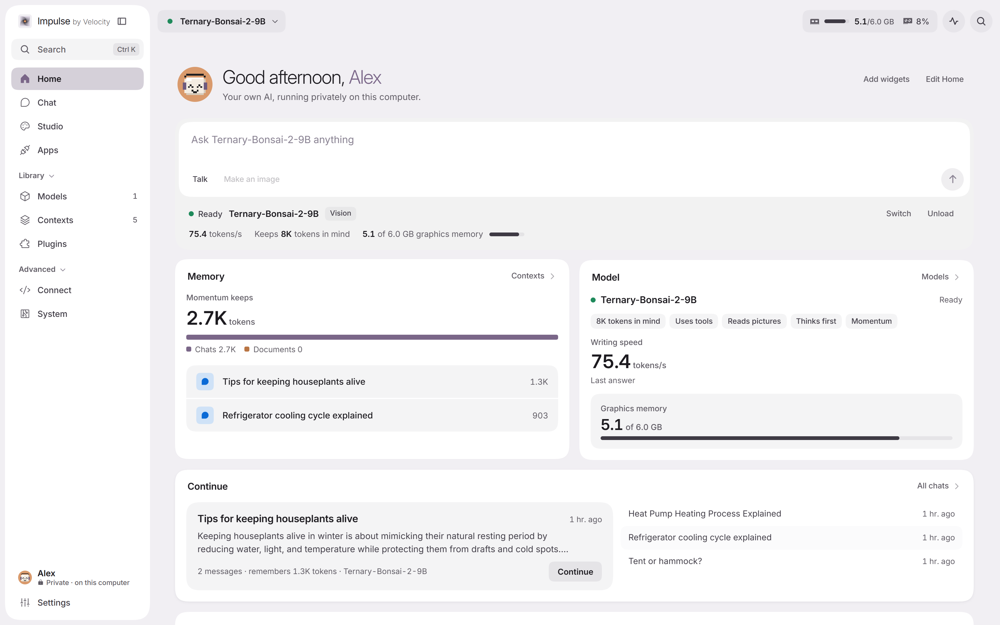<br><sub><b>Light</b></sub></td>
<td width="50%"><picture><source media="(prefers-color-scheme: light)" srcset="assets/screens/settings-appearance-light.png"></picture><br><sub><b>Appearance</b>: themes, accents and fonts</sub></td>
</tr>
</table>

**Your account.** A name for the greeting, and an optional password required before the panel opens. Apps keep working with the API key; the password only protects the panel.

**Backups and restore.** Everything Impulse keeps (chats, preferences, service settings, contexts) in one file you can store anywhere, on a schedule if you like, and restore on a new machine.

<table>
<tr>
<td width="50%" align="center"><br><sub><b>On a phone</b>: the same panel, with a floating bar</sub></td>
<td width="50%"><br><sub><b>Data</b>: back up and restore</sub></td>
</tr>
<tr>
<td width="50%"><br><sub><b>Voice & audio</b>: microphone and speaker, tested in place</sub></td>
<td width="50%">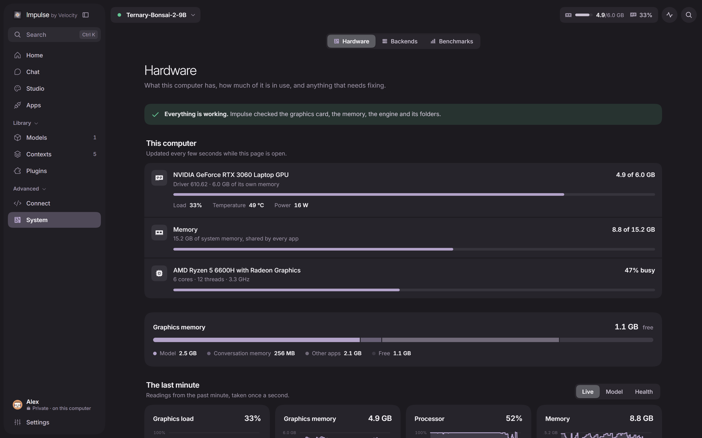<br><sub><b>System</b>: what the machine has and what is using it</sub></td>
</tr>
</table>

**A window or a browser.** Impulse opens in its own window. The same panel works in any browser on this computer at `http://127.0.0.1:11500`.

<p align="right"><sub><a href="#top">Back to top</a></sub></p>

<a name="install"></a>
## Install

One command. No account, no sign-in, no telemetry, no Docker.

**Windows**: [download the installer](https://github.com/Veloresearch/impulse/releases/latest/download/VLSSetup.exe), or in PowerShell:

```powershell
irm https://github.com/Veloresearch/impulse/releases/latest/download/install.ps1 | iex
```

**Linux**: [download the x64 build](https://github.com/Veloresearch/impulse/releases/latest/download/VLS-linux-x64.tar.gz) (a [Vulkan build](https://github.com/Veloresearch/impulse/releases/latest/download/VLS-linux-x64-vulkan.tar.gz) is available too), or:

```bash
curl -fsSL https://github.com/Veloresearch/impulse/releases/latest/download/install.sh | sh
```

The installer checks the machine before it downloads anything and picks the build that suits it:
**CUDA** where there is an NVIDIA card, **Vulkan** on Linux where there is any card at all, and the
**processor** build otherwise. It opens the panel when it is done. Updates install from Settings.
Removing Impulse means deleting one folder; your models and memories are stored separately.

| | |
|---|---|
| **Graphics card** | Optional. A 6 GB card runs a 4B model with every layer on the card; the processor build works everywhere. |
| **Windows installer** | The preview is not code-signed yet. If SmartScreen stops it, choose *More info → Run anyway*. |
| **Linux** | Builds are packaged and tested less than Windows. Computer use is Windows only for now. |
| **Every build** | On the [releases page](https://github.com/Veloresearch/impulse/releases), with the [notes for the latest](https://github.com/Veloresearch/impulse/releases/latest). |

<p align="center"><br><sub>Starting Impulse (<a href="assets/gifs/boot.mp4">MP4</a>)</sub></p>

**The first start shows you around.** Pick a language and a name, choose how much of the app you want
to see, and Impulse tells you what this computer can run before you download anything.

<table>
<tr>
<td width="33%"><br><sub><b>Welcome</b></sub></td>
<td width="33%"><br><sub><b>Your computer</b>, read before any download</sub></td>
<td width="33%"><br><sub><b>Three steps</b> to a first answer</sub></td>
</tr>
</table>

<p align="right"><sub><a href="#top">Back to top</a></sub></p>

<a name="use-it-from-the-agent-you-already-have"></a>
### Use it from the agent you already have

Open **Apps** in the panel and press **Connect** beside the agent you use:

| | | what Connect does |
|---|---|---|
|  | **opencode** | adds Impulse as a regular provider in `~/.config/opencode/opencode.json` and makes it the model opencode starts with |
|  | **Hermes Agent** | points `~/.hermes/config.yaml` at Impulse as its custom endpoint, keeping your previous model to restore |

Not an MCP plug-in and not a bridge: Impulse is the model provider itself, the same way a cloud API would be.

The next time the agent starts, it is talking to the model on your machine. **Disconnect** removes
exactly what Connect added; nothing else in those files is touched, and a backup is kept the first time.

For anything else that speaks the OpenAI API (Continue, Cline, LangChain, your own scripts):

```
Base URL   http://127.0.0.1:11500/v1
API key    anything (none is needed from this computer)
Model      velocity  (or any name: it reaches the loaded model)
```

**What the agent remembers.** Every application gets its own memory without any setup, and a coding
agent gets **one per project**: it says which folder it is working in, and Impulse keeps that project's
memory apart from the others. A new chat in the same project picks up where the last one left off; a
different repository starts clean. Each app can be switched to one shared memory, or to no memory, on its card.

<a name="one-address-for-everything"></a>
### One address for everything

```bash
# chat
curl http://127.0.0.1:11500/v1/chat/completions -H "content-type: application/json" \
  -d '{"model":"velocity","messages":[{"role":"user","content":"hello"}]}'

# speech: any installed voice, or the default for OpenAI voice names
curl http://127.0.0.1:11500/v1/audio/speech -H "content-type: application/json" \
  -d '{"input":"Hello from this computer.","voice":"en_US-ryan-high"}' -o hello.wav

# transcription
curl http://127.0.0.1:11500/v1/audio/transcriptions -F file=@hello.wav

# images
curl http://127.0.0.1:11500/v1/images/generations -H "content-type: application/json" \
  -d '{"prompt":"a watercolor lighthouse at dawn","size":"512x512"}'
```

```python
from openai import OpenAI
client = OpenAI(base_url="http://127.0.0.1:11500/v1", api_key="local")
print(client.chat.completions.create(model="velocity",
      messages=[{"role": "user", "content": "hello"}]).choices[0].message.content)
```

From another machine on your network, the same address works with the key from the panel's **API** page.

<p align="right"><sub><a href="#top">Back to top</a></sub></p>

## See it

<a href="https://youtu.be/QZ6p2Il0MDs"><b>▶ Watch it in action</b></a> (YouTube), or take the short tour from **Settings › General › Guided tour** once it is installed.

Every picture and GIF on this page is a recording of the real app with real model output; the contexts are public open-source code.

<a name="built-on"></a>
## Built on

Impulse is a router with Momentum behind it. The memory, the routing, the hardware fit, the mesh and
the panel are built by Velocity. **[llama.cpp](https://github.com/ggml-org/llama.cpp)** (MIT) runs the GGUF models,
**[stable-diffusion.cpp](https://github.com/leejet/stable-diffusion.cpp)** the pictures, and **[Piper](https://github.com/rhasspy/piper)**
and **[faster-whisper](https://github.com/SYSTRAN/faster-whisper)** the voice. Their licences ship inside every package.

<a name="faq"></a>
## FAQ

**Does anything leave my machine?** No. The only outbound requests are the ones you ask for: searching
Hugging Face, searching the web from Chat, downloading what you chose, and checking for a newer release. No telemetry, no account.

**Do I need a GPU?** No. A graphics card makes it faster; the processor build works everywhere.

**Which models work?** Any GGUF that llama.cpp runs, Piper voices, and diffusion models for Studio.

**How can a 4B model with an 8K window answer across 32M tokens?** Momentum selects the passages each question needs and gives them to the model within its own window. It is not a bigger window. What we measured, and how, is in the [evaluation report](https://veloresearch.com/research/momentum).

**Which model should I use for computer use?** It was tested with Qwen3.5-4B on a 6 GB card, on Notepad and Calculator tasks. Whatever the model, it is held to the permission level you chose.

**Can I turn web search off?** Yes, in Chat's Tools menu. With it off, only questions that are plainly about today are looked up, and the Search button always searches.

**Does computer use work on Linux?** Not yet. Computer use is Windows only for now; the rest of Impulse runs on both.

**Is it open source?** No. Impulse is free for personal use; companies need a licence. Write to
**contact@veloresearch.com**. See [LICENSE](LICENSE).

**Is it finished?** It is a preview. When you find a rough edge,
**[open an issue](https://github.com/Veloresearch/impulse/issues)**; it is the fastest
way to get it fixed.

<p align="right"><sub><a href="#top">Back to top</a></sub></p>

<br>

<div align="center">

### If Impulse is useful to you, a star helps others find it

[](https://github.com/Veloresearch/impulse)

<br>

<a href="https://star-history.com/#Veloresearch/impulse&Date">
  <picture>
    <source media="(prefers-color-scheme: dark)" srcset=".github/stars-dark.svg">
    <source media="(prefers-color-scheme: light)" srcset=".github/stars-light.svg">
    
  </picture>
</a>

<br><br>

<picture>
  <source media="(prefers-color-scheme: dark)" srcset="assets/brand/velocity-logo-on-dark.svg">
  <source media="(prefers-color-scheme: light)" srcset="assets/brand/velocity-logo-on-light.svg">
  
</picture>

**Impulse and Momentum are made by [Velocity](https://veloresearch.com)**

[veloresearch.com](https://veloresearch.com) &nbsp;·&nbsp; [Impulse](https://veloresearch.com/impulse) &nbsp;·&nbsp; [Momentum](https://veloresearch.com/momentum) &nbsp;·&nbsp; [Evaluation report](https://veloresearch.com/research/momentum) &nbsp;·&nbsp; [Releases](https://github.com/Veloresearch/impulse/releases) &nbsp;·&nbsp; [Issues](https://github.com/Veloresearch/impulse/issues) &nbsp;·&nbsp; [@velo_research](https://x.com/velo_research) &nbsp;·&nbsp; [contact@veloresearch.com](mailto:contact@veloresearch.com)

</div>
