<a name="top"></a>

<div align="center">


# Velocity Local Services

### A local model server whose memory is far larger than its window.

A 4B model with an 8,192-token window answered across **32,000,000 tokens** in **653 ms** -
on a 6 GB laptop card. Nothing left the machine.

<br>

<a href="https://github.com/Veloresearch/VLS-32M-Context-Local-LLM/releases/latest/download/VLSSetup.exe"></a>
&nbsp;
<a href="https://github.com/Veloresearch/VLS-32M-Context-Local-LLM/releases/latest/download/VLS-linux-x64.tar.gz"></a>

<br>

[](https://github.com/Veloresearch/VLS-32M-Context-Local-LLM/releases/latest)
[](https://github.com/Veloresearch/VLS-32M-Context-Local-LLM/releases/latest)
[](https://github.com/Veloresearch/VLS-32M-Context-Local-LLM/releases)
[](https://github.com/Veloresearch/VLS-32M-Context-Local-LLM/releases/latest)
[](https://github.com/Veloresearch/VLS-32M-Context-Local-LLM/stargazers)
[](https://github.com/Veloresearch/VLS-32M-Context-Local-LLM/commits)
<br>
[](#install)
[](#install)
[](#velocity-context)
[](#one-address-for-everything)
[](LICENSE)
[](https://veloresearch.com/research/velocity-context)

<br>

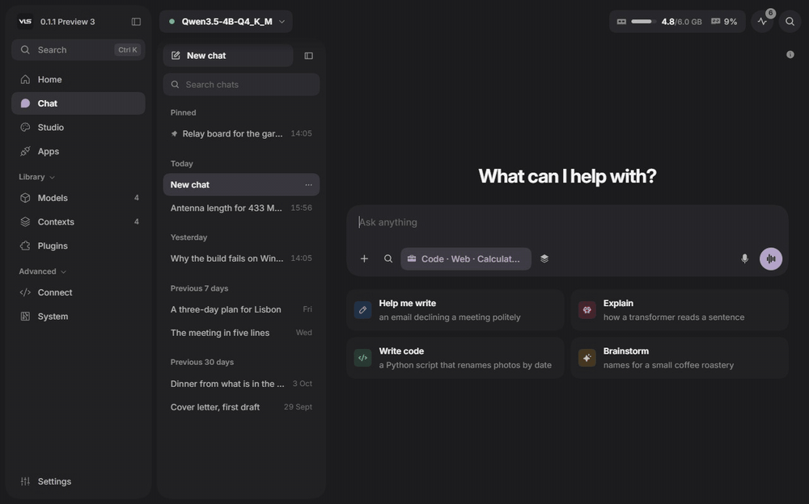

<sub>A real VLS window: the question is looked up first, the pages are read, and the answer cites them.</sub>

<br><br>

<a href="https://youtu.be/QZ6p2Il0MDs"></a>

<sub>▶ <a href="https://youtu.be/QZ6p2Il0MDs"><b>Watch VLS in action</b></a> (YouTube)</sub>

<br><br>

**[Install](#install)** &nbsp;·&nbsp; **[Velocity Context](#velocity-context)** &nbsp;·&nbsp; **[Benchmarks](#measured-not-claimed)** &nbsp;·&nbsp; **[Technical report](https://veloresearch.com/research/velocity-context)** &nbsp;·&nbsp; **[Release notes](https://github.com/Veloresearch/VLS-32M-Context-Local-LLM/releases/latest)** &nbsp;·&nbsp; **[veloresearch.com](https://veloresearch.com)**

</div>

<br>

<details>
<summary><b>What's new in 0.1.1 Preview 3</b> - your local model can now use your computer, by text or by voice</summary>

<br>

- **Computer use.** The model opens apps, clicks, types and fills in forms. Four permission levels, off until you turn it on, and Esc, Stop or the top-left corner halts it at once. [More](#computer-use)
- **The island.** A small bar at the top of the screen for a quick chat, your history, voice, contexts and live activity. Hidden until you need it. [More](#the-island)
- **Talk drives the computer.** Say a task, interrupt at any time, answer permission questions with "yes" or "no".
- **Writing in chat.** Instant typing in long chats, a draft per chat, `@` to attach a file or pick a context, `/` commands, and a token counter as the window fills. [More](#chat)
- **Voice & audio settings.** Choose and test your microphone and speaker; input volume, noise suppression and echo cancellation.
- **Starting VLS.** Opening it always shows its window; starting with Windows stays in the background.

Computer use and the island are Windows only for now. Full notes: **[VLS 0.1.1 Preview 3](https://github.com/Veloresearch/VLS-32M-Context-Local-LLM/releases/tag/v0.1.1-preview.3)** · [all releases](https://github.com/Veloresearch/VLS-32M-Context-Local-LLM/releases)

</details>

## Contents

| | |
|---|---|
| **Start** | [Why VLS](#why-vls) · [Install](#install) · [Questions](#questions-people-actually-ask) |
| **Memory** | [Velocity Context](#velocity-context) · [Measured, not claimed](#measured-not-claimed) |
| **Use it** | [Chat](#chat) · [Computer use](#computer-use) · [The island](#the-island) · [Look inside the model](#look-inside-the-model) |
| **Connect** | [Studio, Plugins and Apps](#studio-plugins-and-apps) · [Use it from the agent you already have](#use-it-from-the-agent-you-already-have) · [One address for everything](#one-address-for-everything) |
| **Yours** | [Make it yours](#make-it-yours) · [See it](#see-it) · [Built on](#built-on) |

<br>

## Why VLS

- **One program for local AI.** Models, chat, voice, pictures and an OpenAI-compatible API on one address, in one install, with a panel that explains itself.
- **Memory that is not limited by the window.** Add a folder, a repository or a year of notes once; every question after that can reach all of it - up to 32M tokens.
- **Private by construction.** No account, no telemetry, no Docker. The only outbound requests are the ones you ask for.

Most local runners load a model and give you its window. VLS does that too, and adds what sits around the model: a memory far larger than the window, tools the model can use, a computer it can operate with your permission, and a way to see how it wrote each answer.

<picture>
  <source media="(prefers-color-scheme: light)" srcset=".github/screens/home-light.png">
  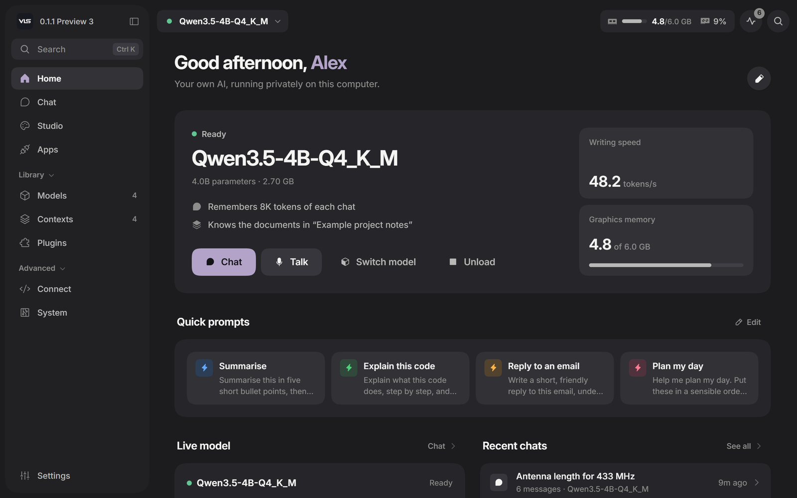
</picture>

<p align="right"><sub><a href="#top">Back to top</a></sub></p>

<a name="install"></a>
## Install

One command. No account, no sign-in, no telemetry, no Docker.

**Windows** - [download VLSSetup.exe](https://github.com/Veloresearch/VLS-32M-Context-Local-LLM/releases/latest/download/VLSSetup.exe), or:

```powershell
irm https://github.com/Veloresearch/VLS-32M-Context-Local-LLM/releases/latest/download/install.ps1 | iex
```

**Linux** - [download the x64 build](https://github.com/Veloresearch/VLS-32M-Context-Local-LLM/releases/latest/download/VLS-linux-x64.tar.gz) (a [Vulkan build](https://github.com/Veloresearch/VLS-32M-Context-Local-LLM/releases/latest/download/VLS-linux-x64-vulkan.tar.gz) is beside it), or:

```bash
curl -fsSL https://github.com/Veloresearch/VLS-32M-Context-Local-LLM/releases/latest/download/install.sh | sh
```

The installer looks at the machine before it downloads anything and takes the build that suits it -
**CUDA** where there is an NVIDIA card, **Vulkan** on Linux where there is any card at all, the
**processor** otherwise - and opens the panel when it is done. Updates install themselves from
Settings. Removing it is deleting one folder; your models and memories live somewhere else.

| | |
|---|---|
| **Graphics card** | Optional. A 6 GB card runs a 4B model with every layer on the card; the processor build works everywhere. |
| **Windows installer** | The preview is not code-signed yet. If SmartScreen stops it, choose *More info → Run anyway*. |
| **Linux** | Builds are packaged and tested less than Windows. Computer use and the island are Windows only for now. |
| **Every build** | On the [releases page](https://github.com/Veloresearch/VLS-32M-Context-Local-LLM/releases), with the [notes for the latest](https://github.com/Veloresearch/VLS-32M-Context-Local-LLM/releases/latest). |

<p align="center"></p>

<p align="right"><sub><a href="#top">Back to top</a></sub></p>

<a name="velocity-context"></a>
## Velocity Context

<div align="center">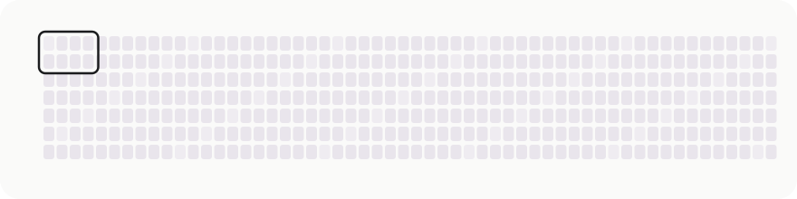</div>

<br>

A model's window is a hard limit paid for in memory. Velocity Context gives the model something to
reach into instead of a bigger window: you add material once - a folder, a repository, your notes, or
simply the conversation as it happens - and every question after that can reach all of it, up to
**32M tokens**.

- **Not RAG.** No embedding model, no vector database, no chunk size, no second service to run.
- **Counted in the model's own tokens.** Sizes are measured with the loaded model's tokenizer, so what you see is what the model sees.
- **On your disk.** A context is a `.mfyc` file you own, built in seconds, outliving any model you load.
- **Explainable.** Every answer carries a receipt with the exact text the model was given.
- **Flat cost.** Thirty-two times the material, the same half second.

| context | one-time build | answer, median | answer, p90 |
|---|---:|---:|---:|
| 1M tokens | 0.5 s | 703 ms | 890 ms |
| 10M tokens | 5.3 s | 570 ms | 1 081 ms |
| 20M tokens | 10.6 s | 708 ms | 1 117 ms |
| **32M tokens** | **17.2 s** | **653 ms** | **1 111 ms** |

<p align="center">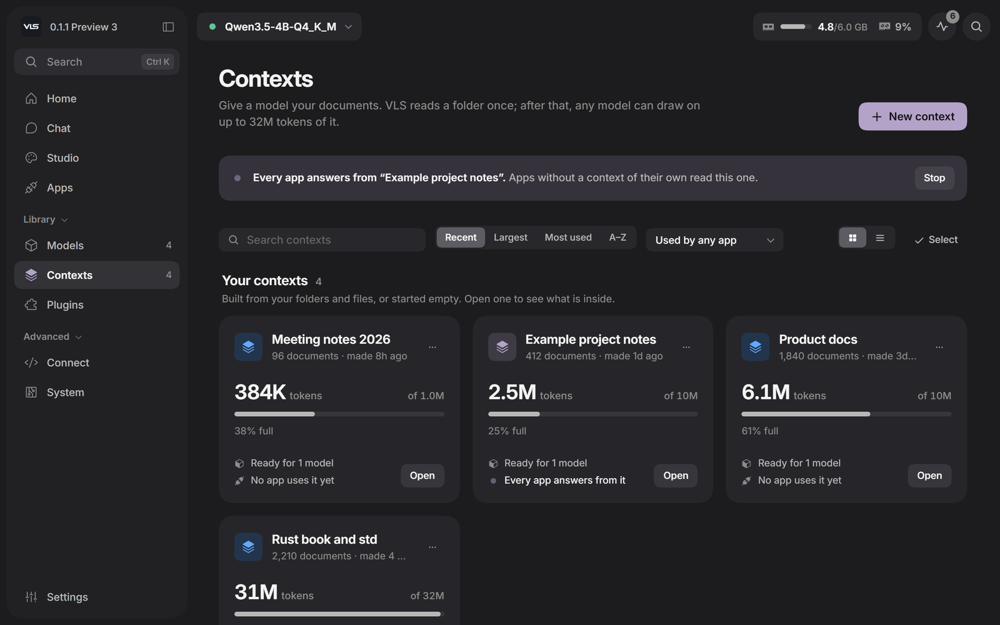</p>

How it was measured, what the controls were and where the results stop are in the
**[technical report](https://veloresearch.com/research/velocity-context)**
([PDF, 14 pages](https://veloresearch.com/reports/velocity-context-evaluation.pdf)).
The method itself we keep to ourselves.

<a name="measured-not-claimed"></a>
### Measured, not claimed

One laptop: **RTX 3060 Laptop, 6 GB**, **Qwen3.5-4B-Q4_K_M**, an **8 192-token window**.

<div align="center">
<br><br>
<br><br>
</div>

<br>

**NVIDIA's RULER**, on their harness, nothing underneath it modified:

| | 4k | 16k | 32k | 64k | 128k |
|---|---:|---:|---:|---:|---:|
| **13-task average** | **100.0** | **74.8** | **85.5** | **89.1** | **86.9** |

**Beyond 128k**, on our own ladder with the same task definitions - reported separately, never averaged in:

| | 1M | 5M | 10M | 15M | 20M | 25M | 32M |
|---|---:|---:|---:|---:|---:|---:|---:|
| **nine-task average** | **97.8** | **95.6** | **100** | **97.8** | **97.8** | **100** | **100** |

The per-task tables, the samples per cell and the parts that do not flatter us are in the
[technical report](https://veloresearch.com/research/velocity-context). Every benchmark can be run on
your own machine from the panel.

<p align="right"><sub><a href="#top">Back to top</a></sub></p>

## Chat

Text, photos and files, voice with live transcription, and a model that looks things up before it answers.

**Search first, with sources.** A question about a part number, a price, a datasheet or anything recent is searched before the model writes a word. You watch the pages being read, and every claim in the answer points back to its source.

**Exact maths.** A built-in calculator works with units, constants and radio and circuit formulas, and shows every step. The model does not do arithmetic in its head.

<table>
<tr>
<td width="50%">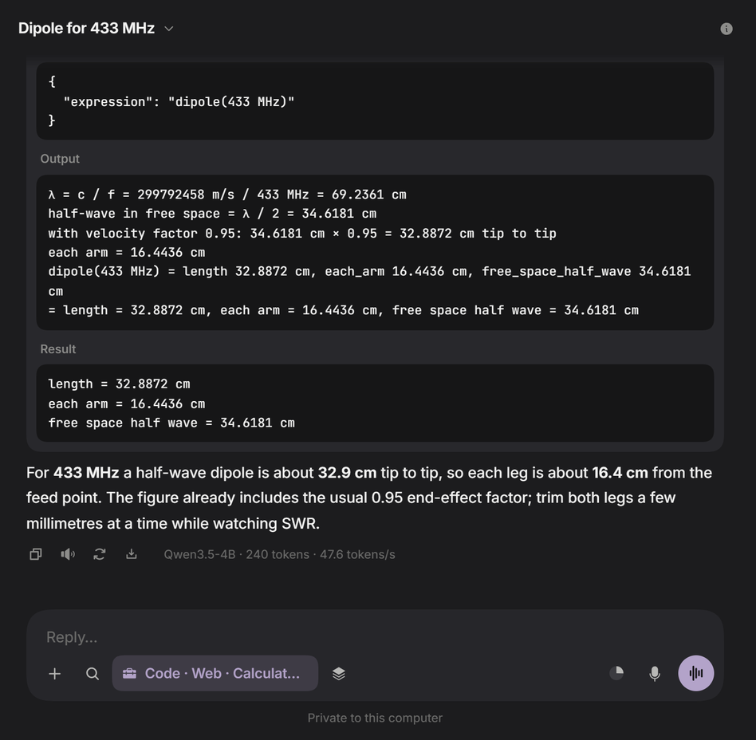<br><sub><b>Calculator</b> - the expression, every step and the result, then the answer</sub></td>
<td width="50%">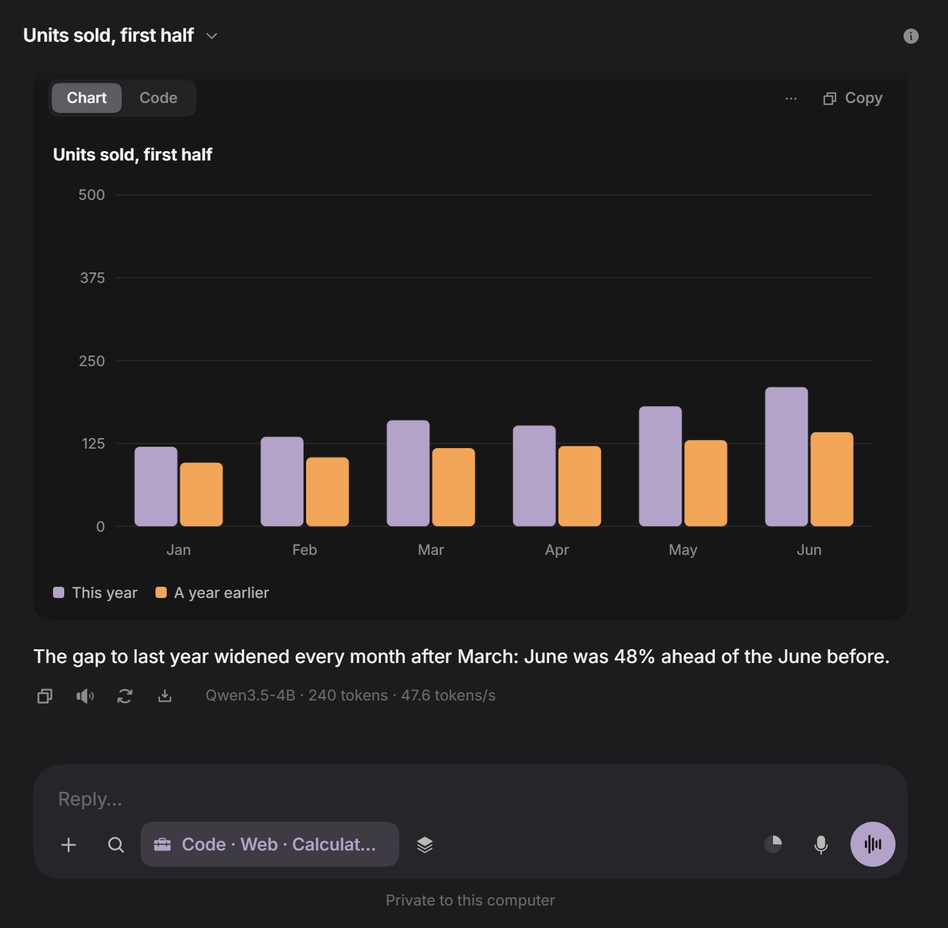<br><sub><b>Charts</b> - drawn from the numbers in the answer, with the data one tab away</sub></td>
</tr>
</table>

**Drawings for electronics.** Schematics are checked before you see them: every pin connected, every value in range. Pin-outs, wiring diagrams and antenna aiming are drawn the same way, and a schematic exports to KiCad.

<table>
<tr>
<td width="50%">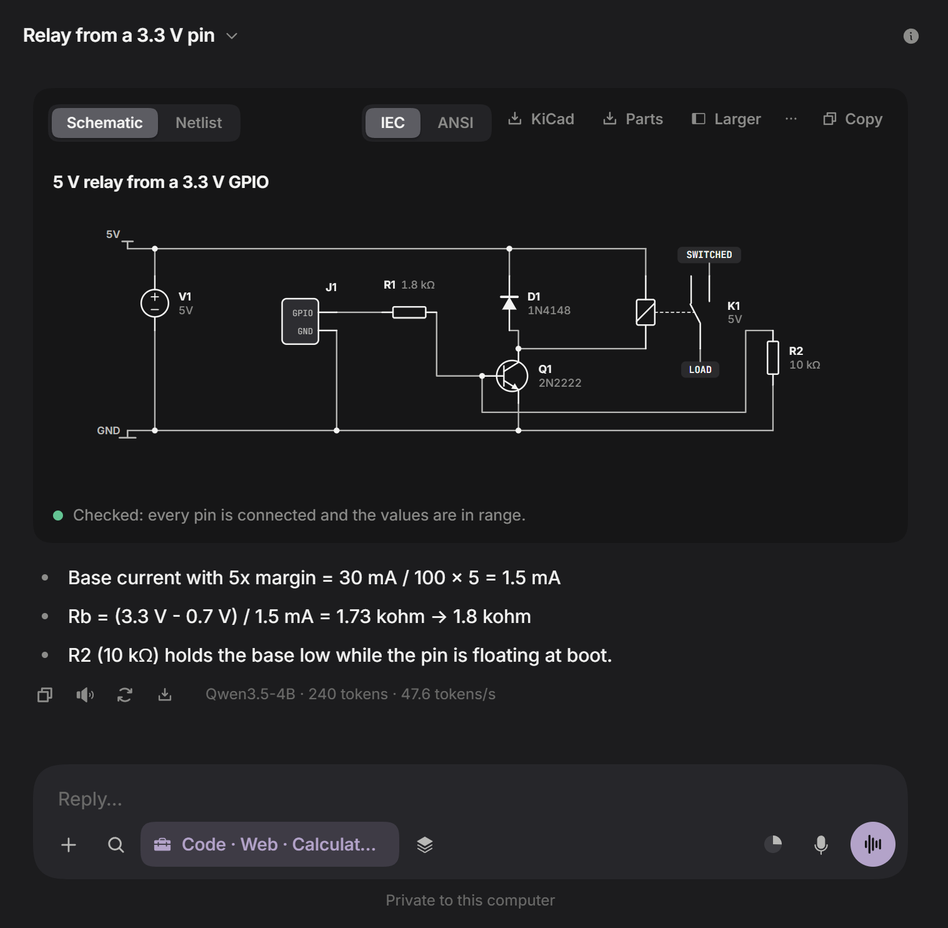<br><sub><b>Schematic</b> - a relay driven from a 3.3 V pin, sized and checked</sub></td>
<td width="50%">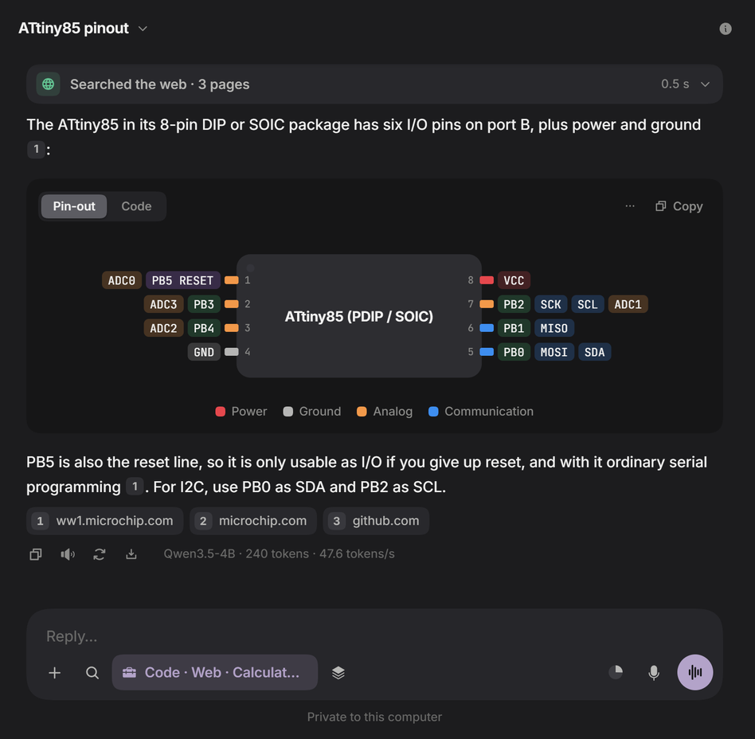<br><sub><b>Pin-out</b> - looked up in the datasheet, then drawn</sub></td>
</tr>
</table>

**A Python sandbox.** The model writes and runs Python in the page - with numpy, pandas and matplotlib, and no internet needed - and the files it makes appear as cards you can open or save.

<p align="center">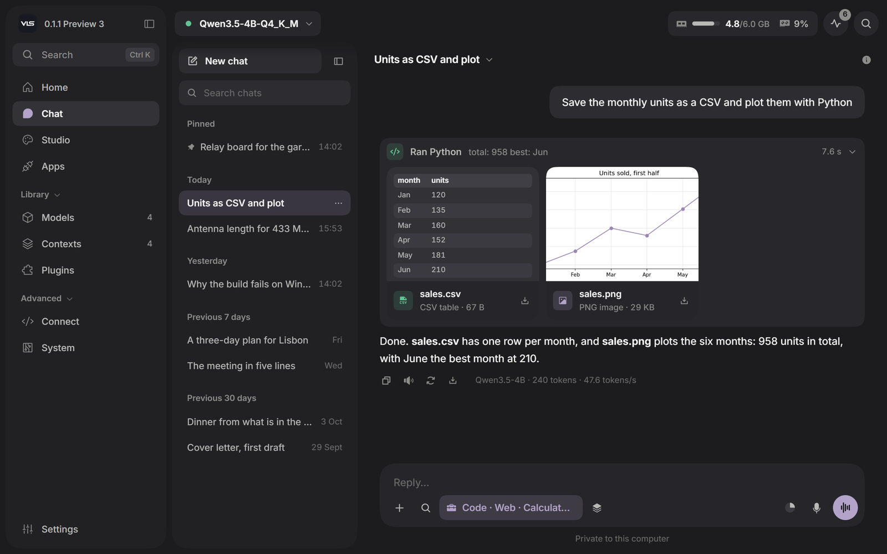</p>

**Everything an answer needs around it.** Save any answer as PDF, Markdown or an image. See what it cost: time to first words, writing speed, tokens read and written, and how much of the window it used. Find anything in a long conversation with Ctrl+F.

<table>
<tr>
<td width="50%">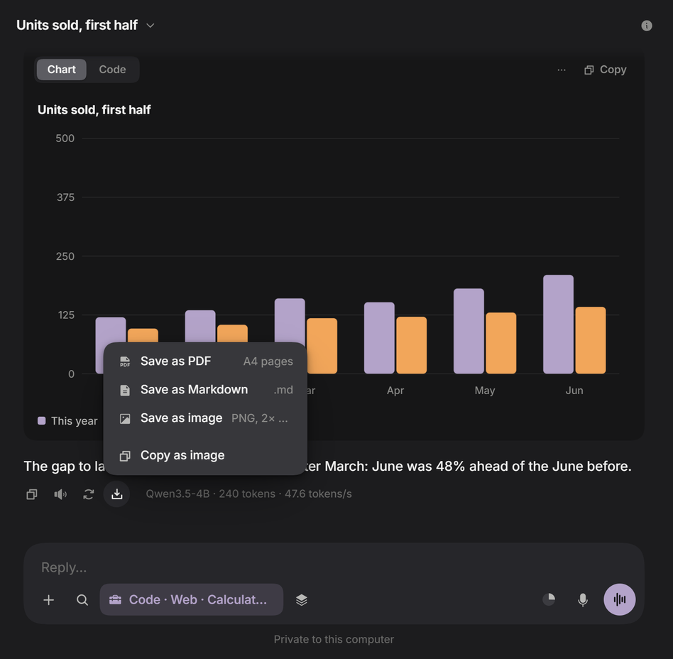<br><sub><b>Save as</b> - PDF, Markdown or an image</sub></td>
<td width="50%">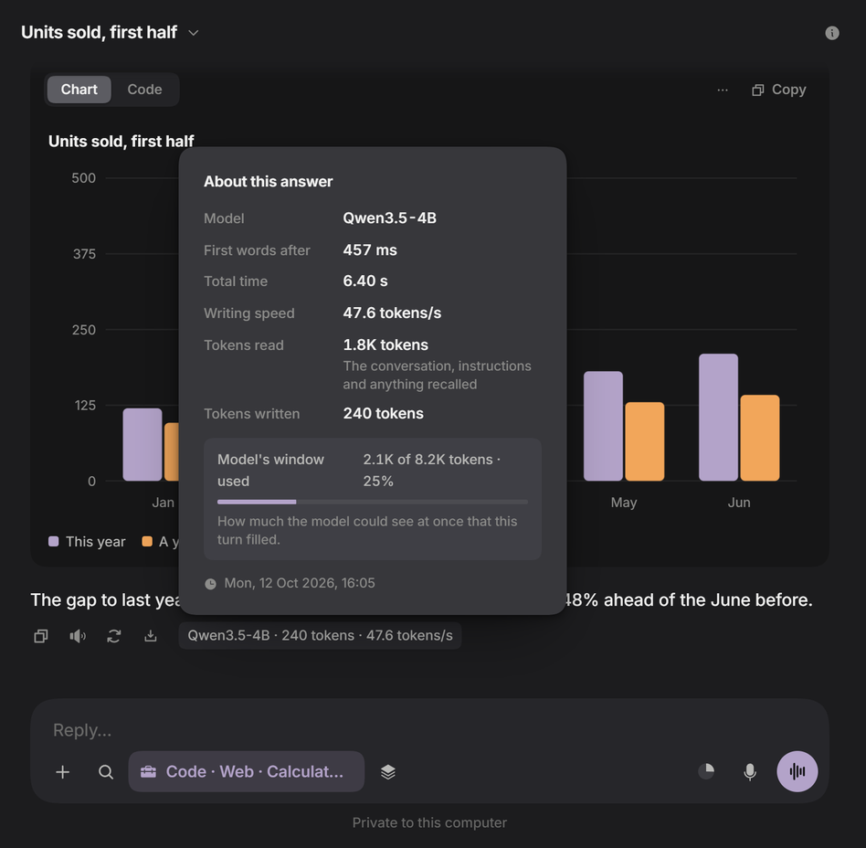<br><sub><b>Answer details</b> - what one answer took</sub></td>
</tr>
<tr>
<td width="50%">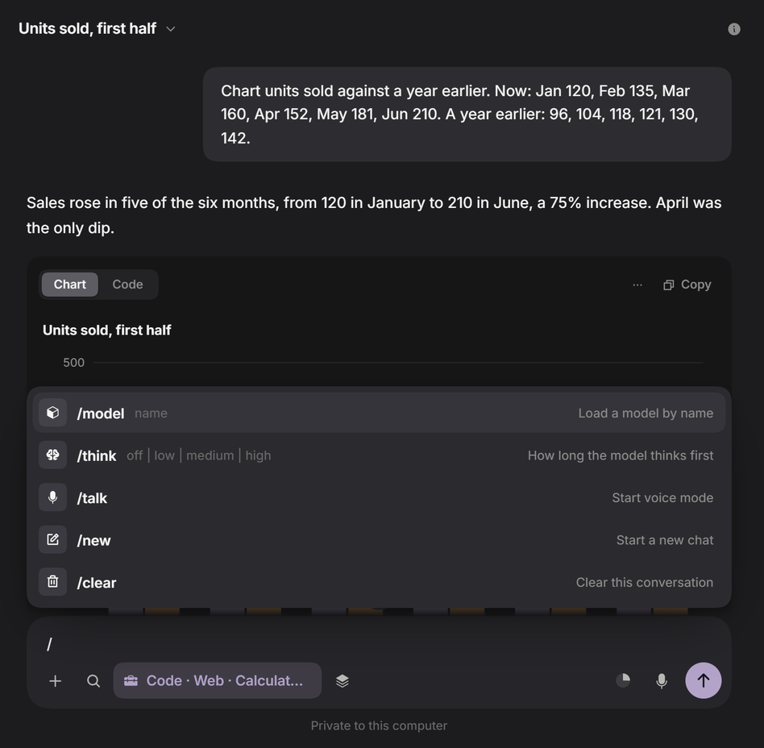<br><sub><b>/ commands</b> - load a model, set thinking, start voice</sub></td>
<td width="50%">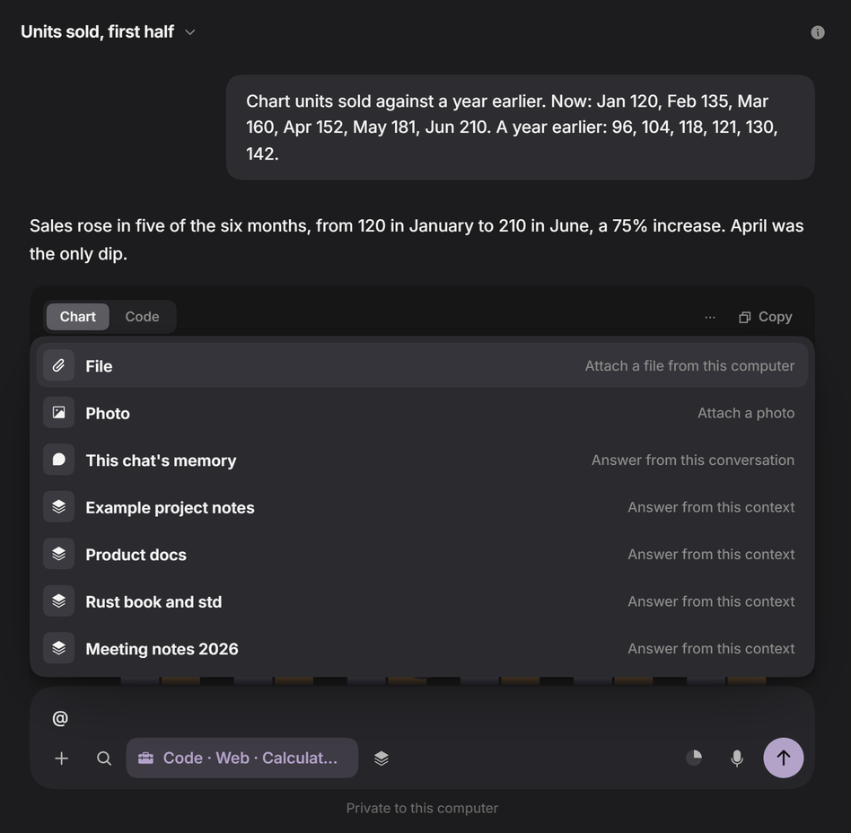<br><sub><b>@ mentions</b> - attach a file or answer from a context</sub></td>
</tr>
</table>

Enter sends, Shift+Enter starts a new line, Esc stops, ↑ edits your last message. Long pasted text becomes a chip with its size in tokens.

<p align="right"><sub><a href="#top">Back to top</a></sub></p>

## Computer use

Your local model can open apps, click, type and fill in forms. It reads each window's buttons and fields directly instead of guessing from pixels, and falls back to a screenshot for apps that do not describe themselves.

<table>
<tr>
<td width="46%" valign="top">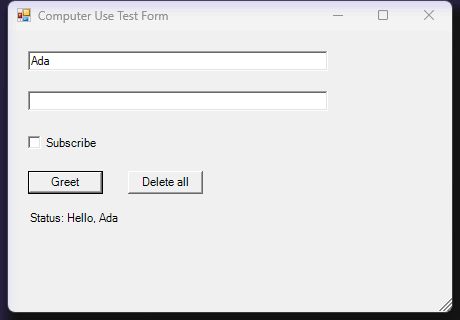</td>
<td valign="top">

**Its own cursor.** A calm second pointer shows where it is going and what it is doing. Your mouse stays yours.

**You decide how much it may do.** Watch only, Ask every time, Ask before risky actions (the default), or Act without asking. It is off until you turn it on.

**You can always stop it.** Esc, Stop, or pushing the mouse into the top-left corner halts it at once. Pause, Take over and Continue hand control back and forth.

</td>
</tr>
</table>

- It never types into password fields, always asks before closing unsaved work, and never acts on a window you did not name.
- Pick which screen it works on. Every action goes into an activity log.
- It works with the sandbox: take something from the screen, process it in Python, put the result back.
- Voice drives it too: say a task in [Talk](#the-island), interrupt at any time, answer approvals with "yes" or "no".

**Measured.** Tested with Qwen3.5-4B on Notepad and Calculator tasks: 4 of 4 passed. Reading a window takes 40-120 ms, and an action takes about half a second.

<table>
<tr>
<td width="50%">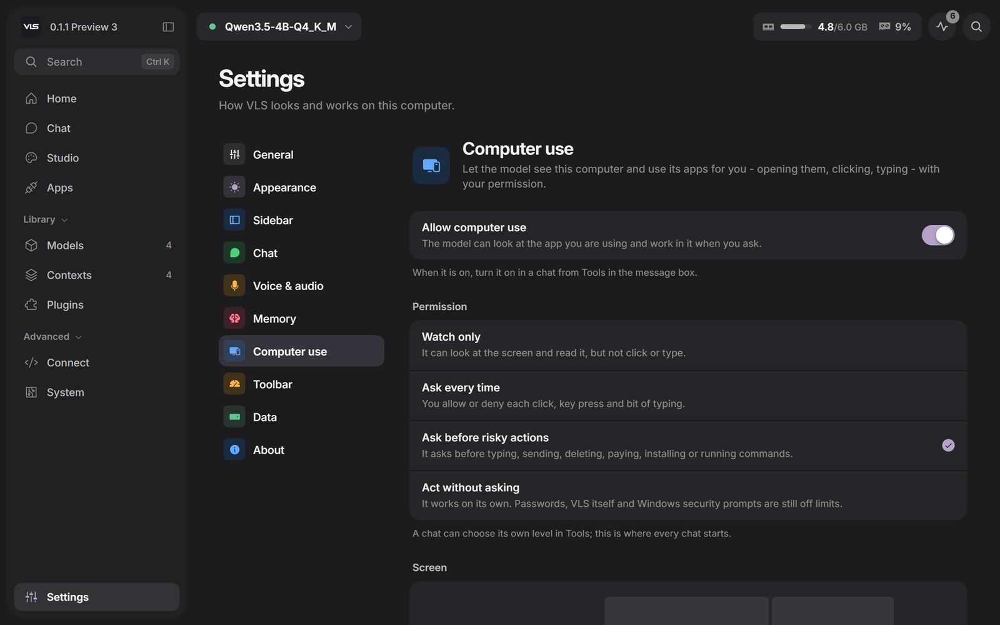<br><sub><b>Permission</b> - four levels, one switch</sub></td>
<td width="50%">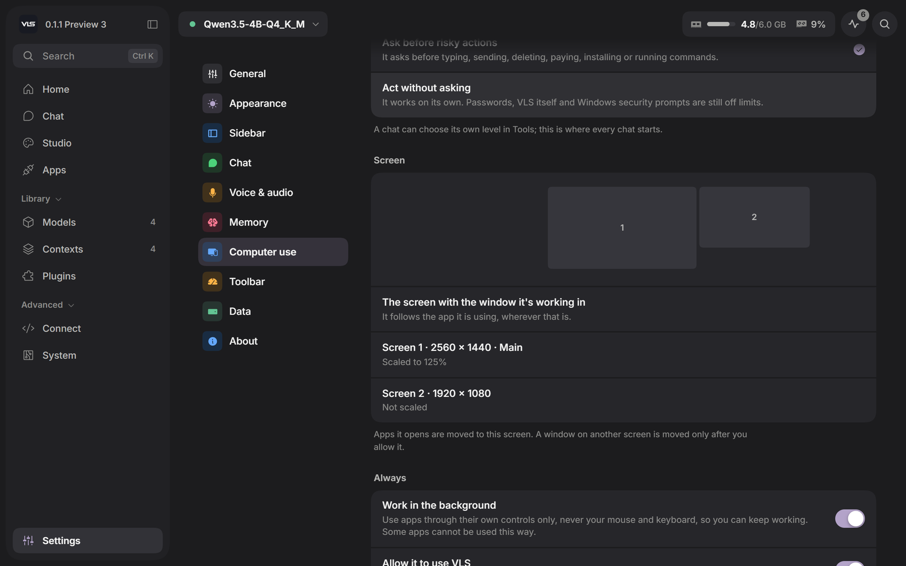<br><sub><b>Screen</b> - which display it works on</sub></td>
</tr>
</table>

Computer use is new and Windows only. Start with *Ask before risky actions*, and check what matters.

<p align="right"><sub><a href="#top">Back to top</a></sub></p>

## The island

A small bar at the top of the screen, hidden until you need it. Chat without opening VLS, pick up a conversation, talk, choose a context, or watch what VLS is doing.

<p align="center"></p>

**Open it** by holding the pointer at the top edge of the screen, pressing the shortcut (Alt+Space by default, changeable in Settings), or dragging a file to the top of the screen. It hides in full-screen apps and games.

<table>
<tr>
<td width="50%">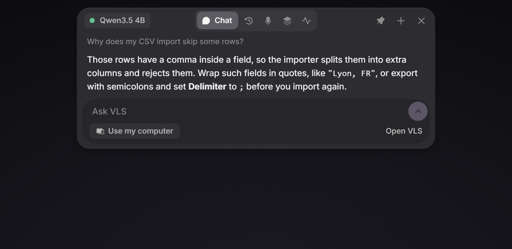<br><sub><b>Chat</b> - a quick question, without opening VLS</sub></td>
<td width="50%">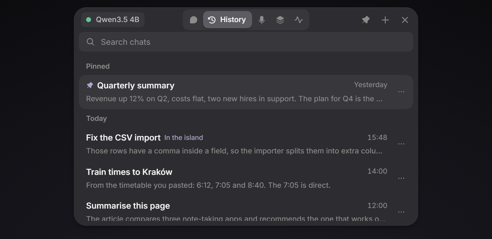<br><sub><b>History</b> - every chat, searchable</sub></td>
</tr>
<tr>
<td width="50%">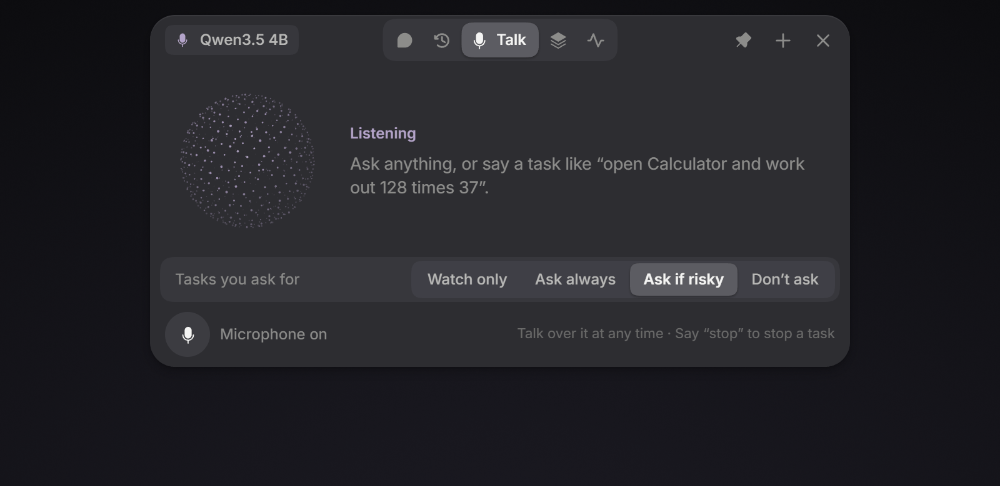<br><sub><b>Talk</b> - say a task; say "stop" to stop it</sub></td>
<td width="50%">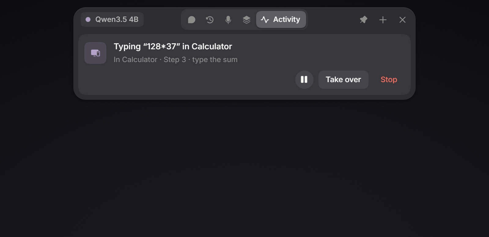<br><sub><b>Activity</b> - the current step, with Pause, Take over and Stop</sub></td>
</tr>
<tr>
<td width="50%">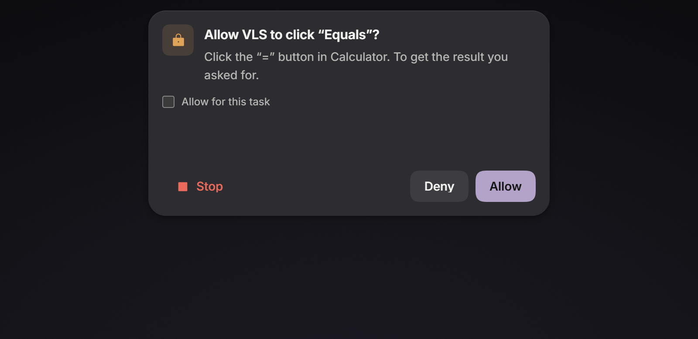<br><sub><b>Approvals</b> - Allow, Deny, or allow for this task</sub></td>
<td width="50%"><br><br><sub><b>While VLS works</b> - a live bar for answers, downloads, loading and tasks</sub></td>
</tr>
</table>

<p align="center">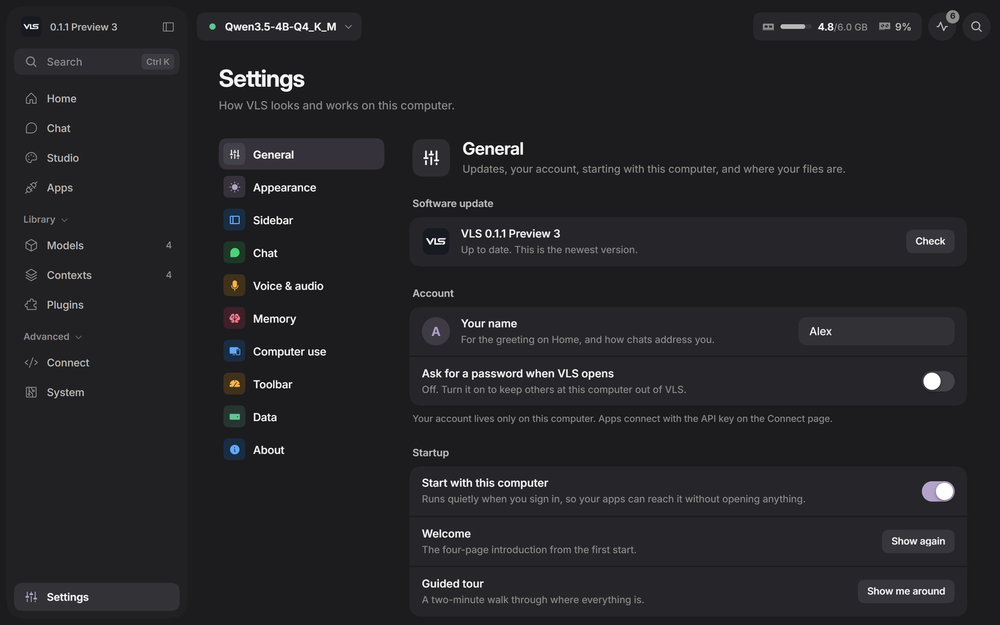</p>

<p align="right"><sub><a href="#top">Back to top</a></sub></p>

## Look inside the model

How the last answer was written, one token at a time: what the model chose, how sure it was, and what it nearly said. Then the model itself - every layer, read straight from its file.

<p align="center">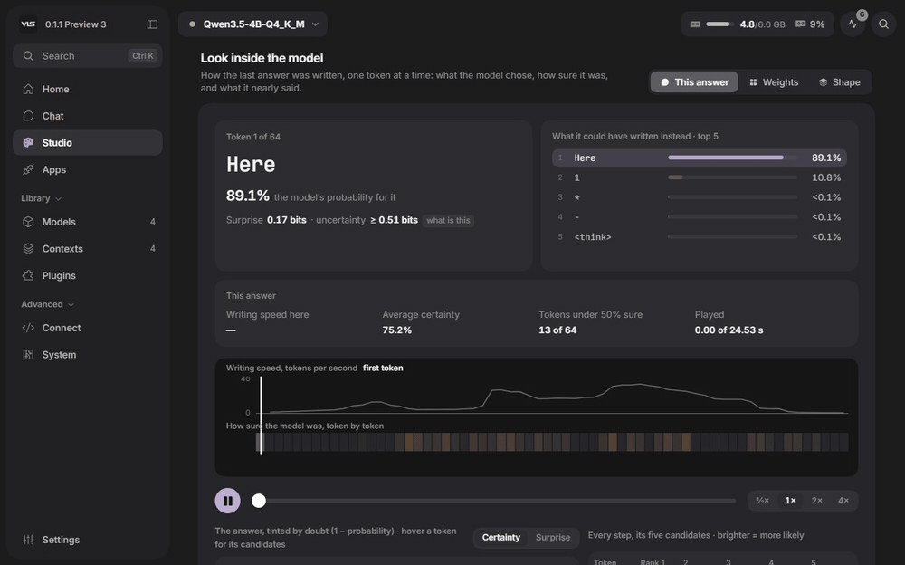</p>

<table>
<tr>
<td width="50%">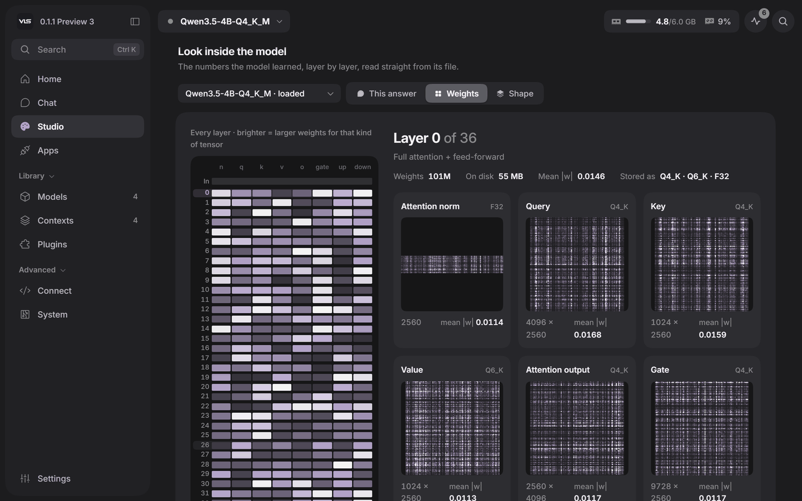<br><sub><b>Weights</b> - every layer, brighter where the weights are larger</sub></td>
<td width="50%">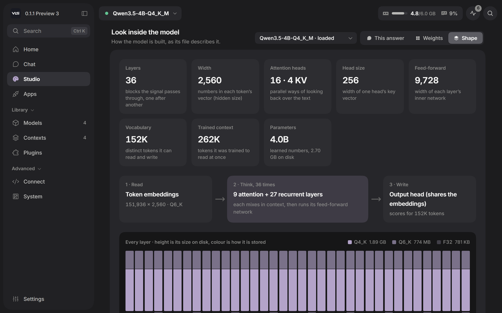<br><sub><b>Shape</b> - how the model is built, as its file describes it</sub></td>
</tr>
</table>

<sub>The weight pictures above are drawn from sample data for this page; in VLS they come from the model you have loaded.</sub>

<p align="right"><sub><a href="#top">Back to top</a></sub></p>

<a name="studio-plugins-and-apps"></a>
## Studio, Plugins and Apps

| | |
|---|---|
| **Studio** | Images and video from local diffusion models, speech in over a hundred Piper voices, all on this machine. |
| **Models** | Search Hugging Face from the panel; each build is checked against your card *before* it downloads. |
| **Plugins** | Any MCP server - a folder, GitHub, a database - with one-click presets. Switched-on plugins offer their tools in Chat. |
| **Apps** | One-press connection for opencode and Hermes Agent; the address for everything else. |
| **Mesh** | Every machine in your house as one - a model too big for one card is split across them. |

<table>
<tr>
<td width="50%">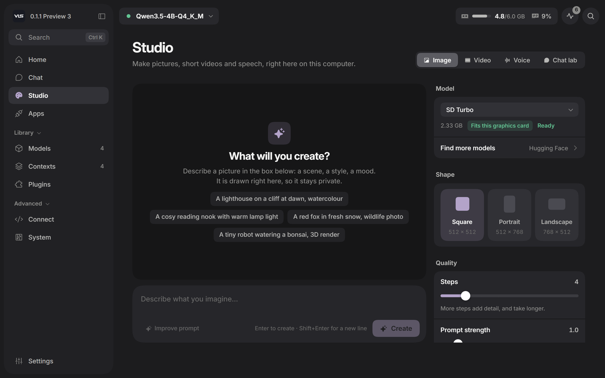<br><sub><b>Studio</b> - pictures, video and speech</sub></td>
<td width="50%">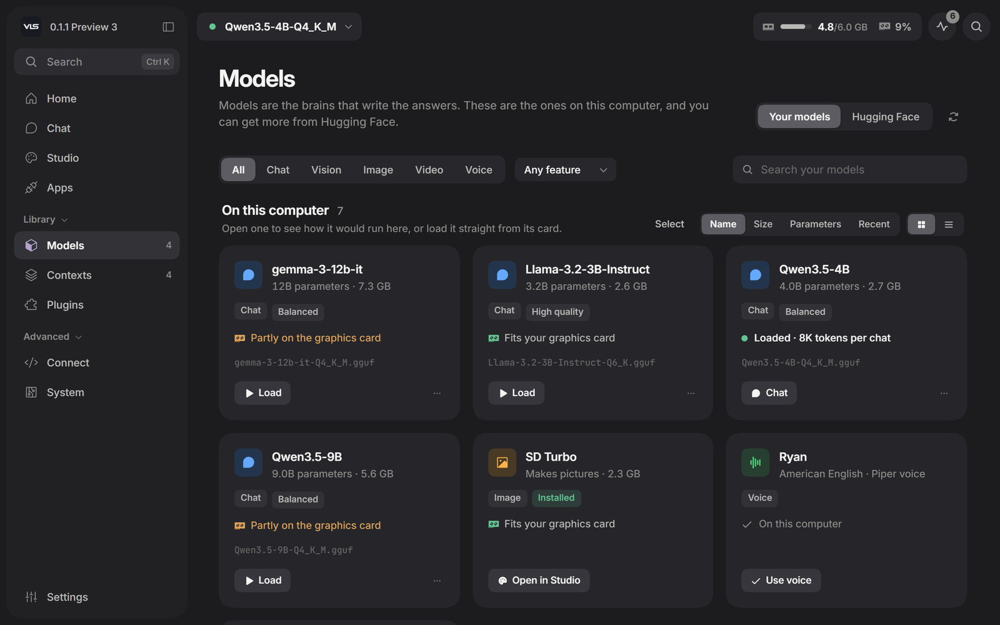<br><sub><b>Models</b> - what fits your card, before it downloads</sub></td>
</tr>
<tr>
<td width="50%">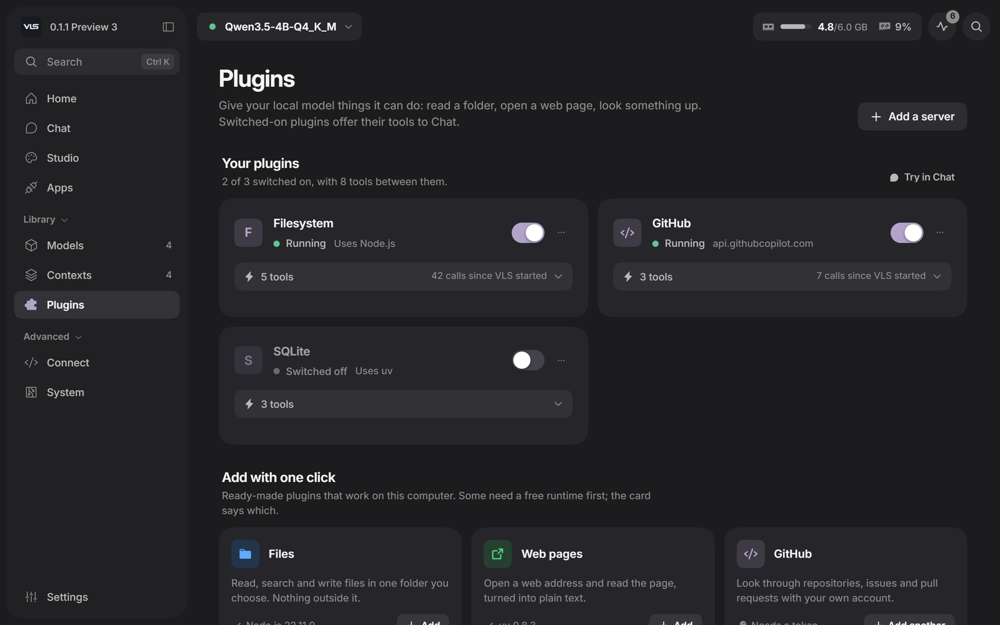<br><sub><b>Plugins</b> - MCP servers, started and watched by VLS</sub></td>
<td width="50%">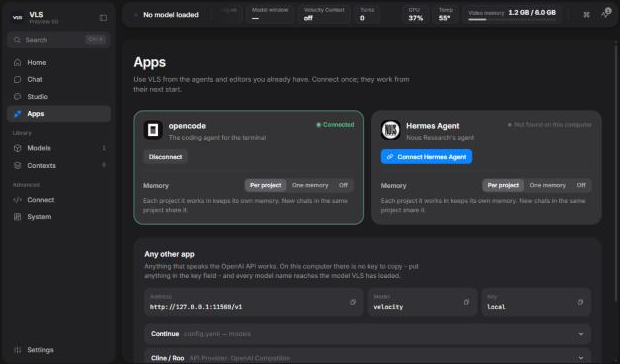<br><sub><b>Apps</b> - connect an agent in one press</sub></td>
</tr>
</table>

<div align="center"><br>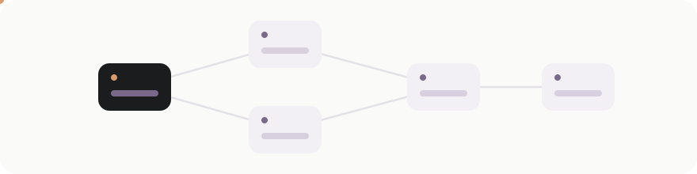<br><br></div>

<a name="use-it-from-the-agent-you-already-have"></a>
### Use it from the agent you already have

<div align="center">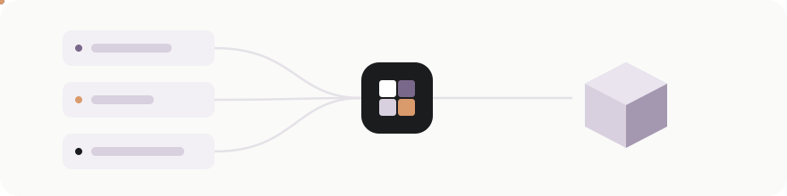</div>

<br>

Open **Apps** in the panel and press **Connect** beside the agent you use:

| | | what Connect does |
|---|---|---|
|  | **opencode** | adds VLS as a normal provider in `~/.config/opencode/opencode.json` and makes it the model opencode starts with |
|  | **Hermes Agent** | points `~/.hermes/config.yaml` at VLS as its custom endpoint, keeping your previous model to put back |

Not an MCP plug-in and not a bridge: VLS is the model provider itself, the same way a cloud API would be.

The next time the agent starts, it is talking to the model on your machine. **Disconnect** removes
exactly what Connect added; nothing else in those files is touched, and a backup is kept the first time.

For anything else that speaks the OpenAI API - Continue, Cline, LangChain, your own script:

```
Base URL   http://127.0.0.1:11500/v1
API key    anything (none is needed from this computer)
Model      velocity  (or any name - it reaches the loaded model)
```

**What the agent remembers.** Every application gets its own memory without anyone setting it up, and a coding agent gets **one
per project** - it says which folder it is working in, and VLS keeps that project's memory apart from
the others. A new chat in the same project picks up where the last one left off; a different repository
starts clean. Each app can be switched to one shared memory, or to remembering nothing, on its card.

<a name="one-address-for-everything"></a>
### One address for everything

```bash
# chat
curl http://127.0.0.1:11500/v1/chat/completions -H "content-type: application/json" \
  -d '{"model":"velocity","messages":[{"role":"user","content":"hello"}]}'

# speech - any installed voice, or the default for OpenAI voice names
curl http://127.0.0.1:11500/v1/audio/speech -H "content-type: application/json" \
  -d '{"input":"Hello from this computer.","voice":"en_US-ryan-high"}' -o hello.wav

# listening
curl http://127.0.0.1:11500/v1/audio/transcriptions -F file=@hello.wav

# pictures
curl http://127.0.0.1:11500/v1/images/generations -H "content-type: application/json" \
  -d '{"prompt":"a small orange cube with a face, pixel art","size":"512x512"}'
```

```python
from openai import OpenAI
client = OpenAI(base_url="http://127.0.0.1:11500/v1", api_key="local")
print(client.chat.completions.create(model="velocity",
      messages=[{"role": "user", "content": "hello"}]).choices[0].message.content)
```

From another machine on your network the same address works with the key from the panel's **API** page.

<p align="right"><sub><a href="#top">Back to top</a></sub></p>

## Make it yours

**Home and the sidebar, arranged your way.** Drag widgets by their handles, change their size, add or take off what you do not use. The sidebar shows what you choose, in your order, under your headings.

<table>
<tr>
<td width="50%">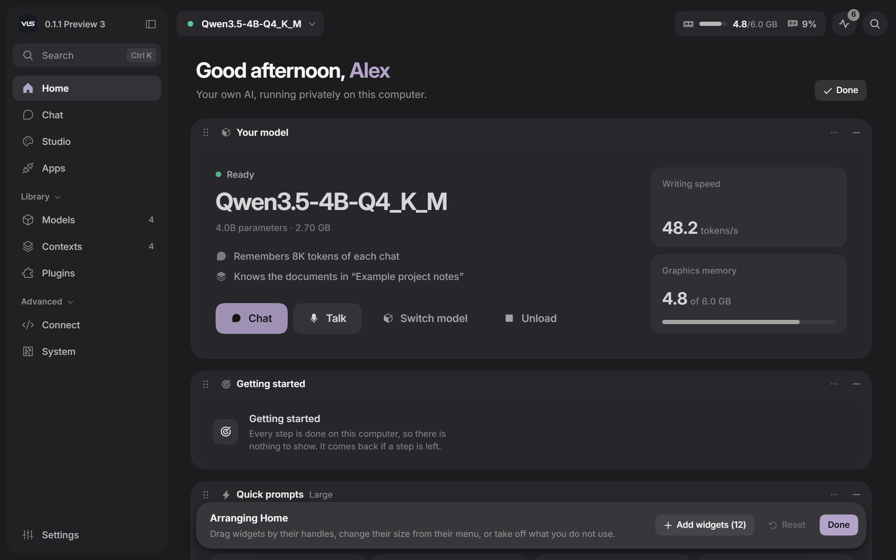<br><sub><b>Arranging Home</b></sub></td>
<td width="50%">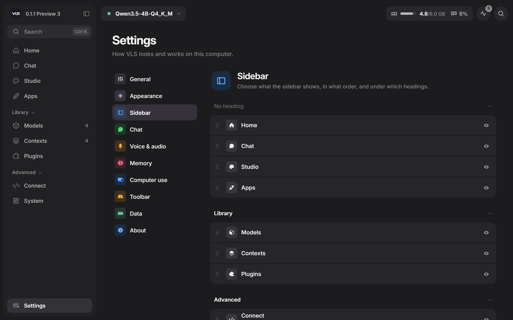<br><sub><b>Sidebar</b></sub></td>
</tr>
</table>

**Themes.** Dark, Slate, Light and Cream, or follow the system, with nine accents.

<table>
<tr>
<td width="50%">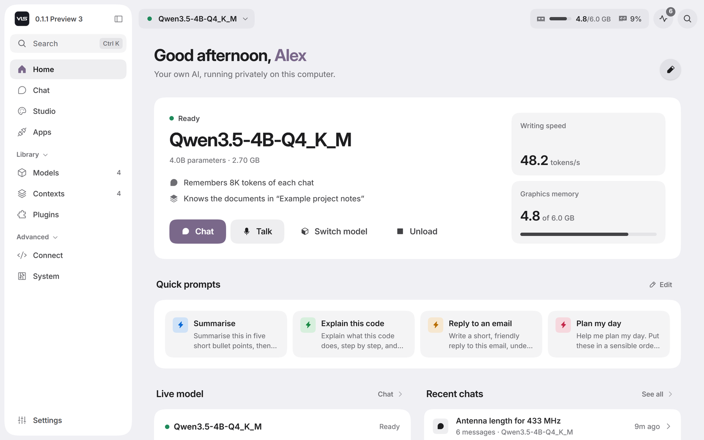<br><sub><b>Light</b></sub></td>
<td width="50%">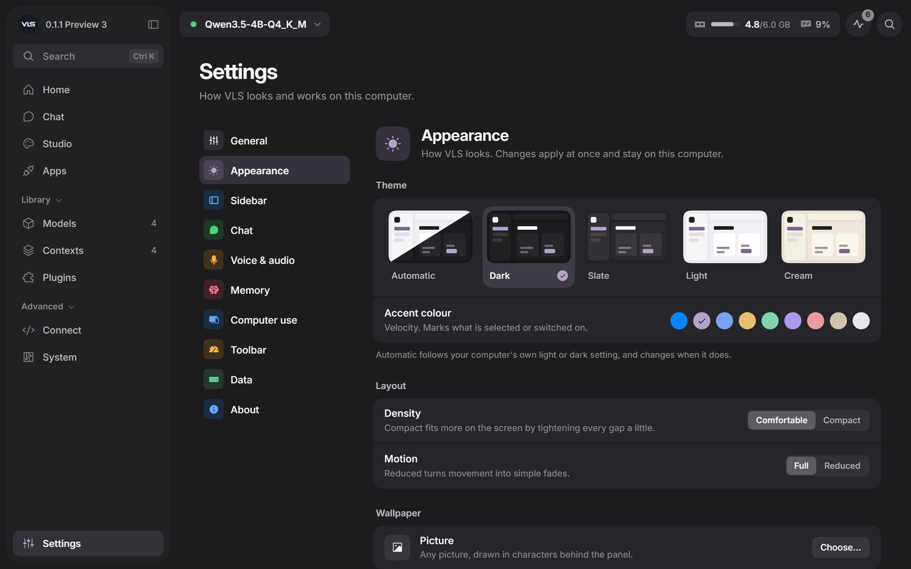<br><sub><b>Appearance</b></sub></td>
</tr>
</table>

**Your account.** A name for the greeting, and an optional password that has to be typed before the panel opens. Apps keep working with the API key; the password only guards the panel.

**Backups and restore.** Everything VLS keeps - chats, preferences, service settings, contexts - in one file you can store anywhere, on a schedule if you like, and put back on a new machine.

<table>
<tr>
<td width="50%">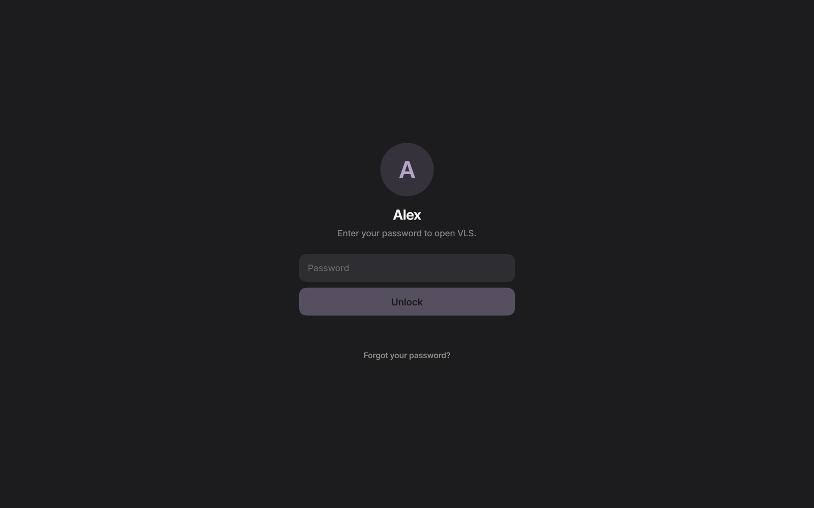<br><sub><b>Lock screen</b></sub></td>
<td width="50%">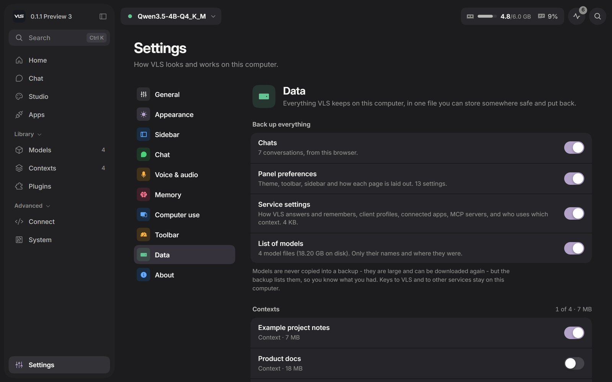<br><sub><b>Data</b> - back up and restore</sub></td>
</tr>
<tr>
<td width="50%">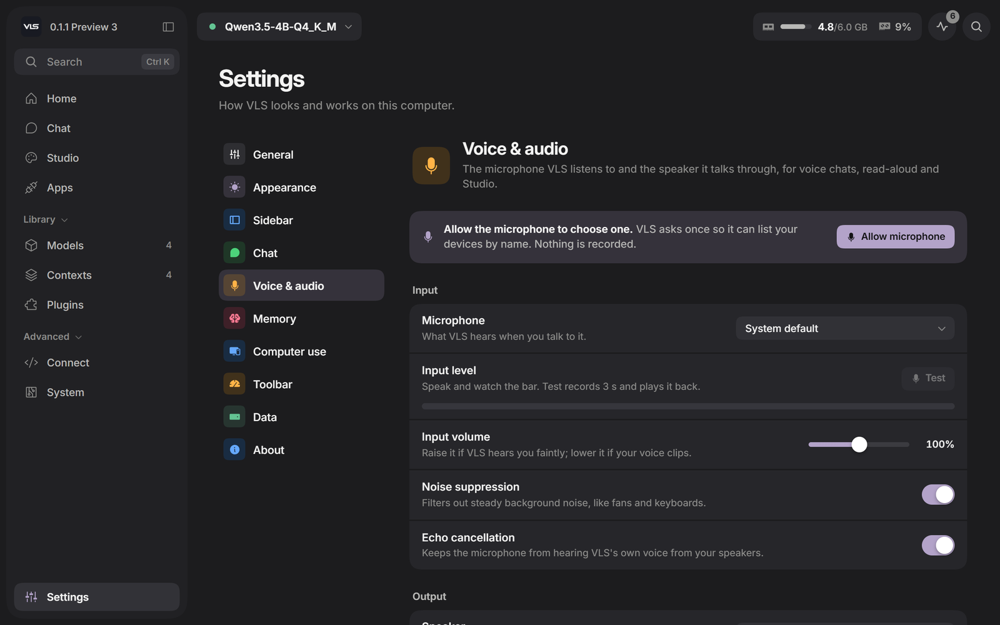<br><sub><b>Voice & audio</b> - microphone and speaker, tested in place</sub></td>
<td width="50%">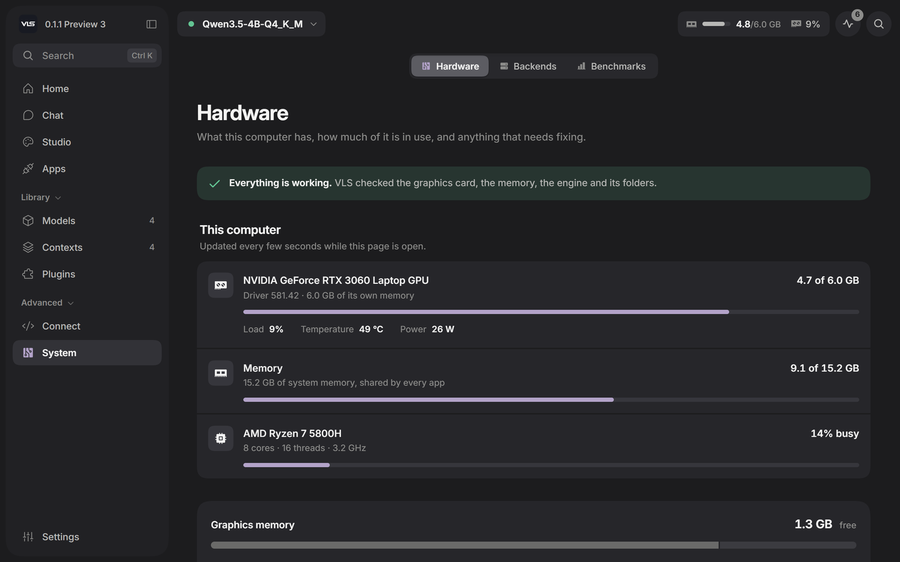<br><sub><b>System</b> - what the machine has and what is using it</sub></td>
</tr>
</table>

**A window or a browser.** VLS opens in its own window. The same panel works in any browser on this computer at `http://127.0.0.1:11500`.

<p align="right"><sub><a href="#top">Back to top</a></sub></p>

## See it

<a href="https://youtu.be/QZ6p2Il0MDs"><b>▶ Watch VLS in action</b></a> (YouTube) - or take the short tour from **Settings › General › Guided tour** once it is installed.

Every picture on this page is a capture of the real VLS panel, filled with sample conversations, models and contexts.

<a name="built-on"></a>
## Built on

VLS is a router with Velocity Context behind it. The memory, the routing, the hardware fit, the mesh and
the panel are ours. **[llama.cpp](https://github.com/ggml-org/llama.cpp)** (MIT) runs the GGUF models,
**[stable-diffusion.cpp](https://github.com/leejet/stable-diffusion.cpp)** the pictures, **[Piper](https://github.com/rhasspy/piper)**
and **[faster-whisper](https://github.com/SYSTRAN/faster-whisper)** the voice - their licences travel inside every package.

<a name="questions-people-actually-ask"></a>
## Questions people actually ask

**Does anything leave my machine?** No. The only outbound requests are the ones you ask for: searching
Hugging Face, searching the web from Chat, downloading what you chose, and checking for a newer release. No telemetry, no account.

**Do I need a GPU?** No. A card makes it faster; the processor build works everywhere.

**Which models work?** Any GGUF that llama.cpp runs, Piper voices, and diffusion models for Studio.

**How can a 4B model with an 8K window answer across 32M tokens?** Velocity Context, which is not RAG and not a bigger window. What we measured, and how, is in the [technical report](https://veloresearch.com/research/velocity-context); the method itself we keep to ourselves.

**Which model should I use for computer use?** It was tested with Qwen3.5-4B on a 6 GB card, on Notepad and Calculator tasks. Whatever the model, it is held to the permission level you chose.

**Can I turn web search off?** Yes, in Chat's Tools menu. With it off, only questions that are plainly about today are looked up, and the Search button always searches.

**Does the island work on Linux?** Not yet. The island and computer use are Windows only in Preview 3; the rest of VLS runs on both.

**Is it open source?** No. VLS is free for personal use; companies need a licence - write to
**contact@veloresearch.com**. See [LICENSE](LICENSE).

**Is it finished?** It is a preview. When you find a rough edge,
**[open an issue](https://github.com/Veloresearch/VLS-32M-Context-Local-LLM/issues)** - it is the fastest
way to get it fixed.

<p align="right"><sub><a href="#top">Back to top</a></sub></p>

<br>

<div align="center">


### If VLS is useful to you, a star is the whole ask

[](https://github.com/Veloresearch/VLS-32M-Context-Local-LLM)

<br>

<a href="https://star-history.com/#Veloresearch/VLS-32M-Context-Local-LLM&Date">
  <picture>
    <source media="(prefers-color-scheme: dark)" srcset="https://api.star-history.com/svg?repos=Veloresearch/VLS-32M-Context-Local-LLM&type=Date&theme=dark">
    <source media="(prefers-color-scheme: light)" srcset="https://api.star-history.com/svg?repos=Veloresearch/VLS-32M-Context-Local-LLM&type=Date">
    
  </picture>
</a>

<br><br>


**Made by [Velocity](https://veloresearch.com)** · local runtimes and long-context execution

[veloresearch.com](https://veloresearch.com) &nbsp;·&nbsp; [Technical report](https://veloresearch.com/research/velocity-context) &nbsp;·&nbsp; [Releases](https://github.com/Veloresearch/VLS-32M-Context-Local-LLM/releases) &nbsp;·&nbsp; [Issues](https://github.com/Veloresearch/VLS-32M-Context-Local-LLM/issues) &nbsp;·&nbsp; [@velo_research](https://x.com/velo_research) &nbsp;·&nbsp; [contact@veloresearch.com](mailto:contact@veloresearch.com)

</div>
